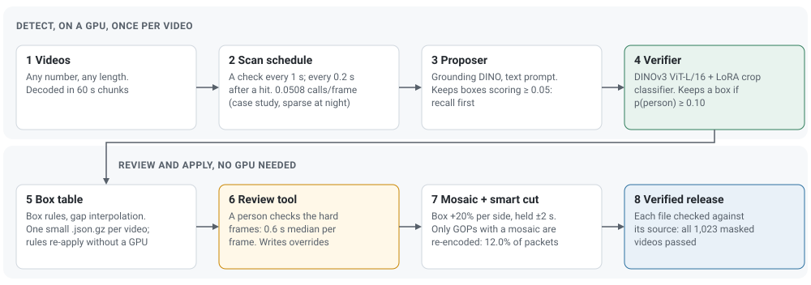
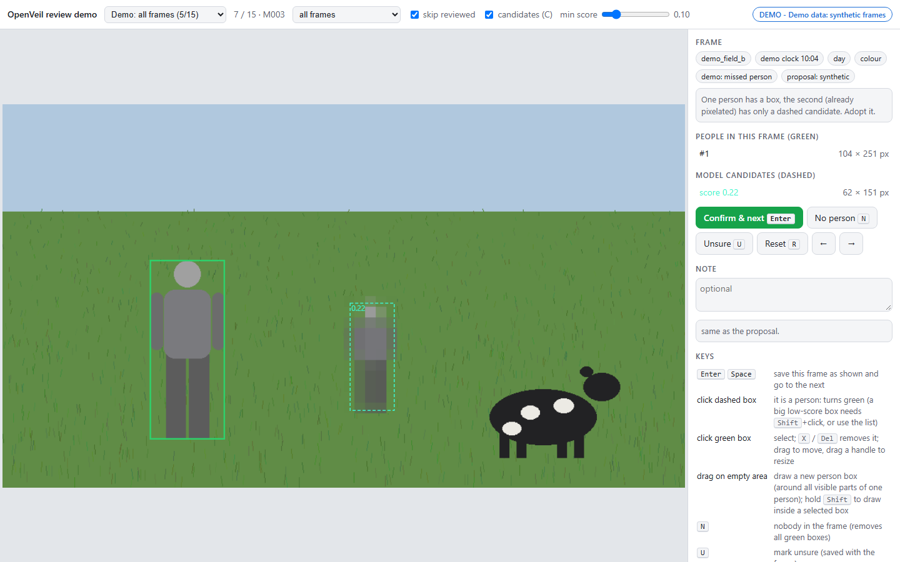

<p align="center">
  
</p>

<h1 align="center">Share your video dataset, not the people in it</h1>

<p align="center"><b>OpenVeil</b>: detect, verify and mosaic people in video datasets before release, with an interactive human review tool.</p>

<p align="center">
  <a href="https://sonam525.github.io/OpenVeil/"></a>
  <a href="https://huggingface.co/Sonam5/OpenVeil-Verifier-DINOv3-ViT-L16"></a>
  <a href="https://huggingface.co/datasets/Sonam5/Calf-Play-Behavior-Dataset"></a>
  <a href="LICENSE"></a>
  <a href="pyproject.toml"></a>
</p>

<p align="center">
  <a href="#how-it-works">How it works</a> ·
  <a href="#results">Results</a> ·
  <a href="#examples">Examples</a> ·
  <a href="#review-tool">Review tool</a> ·
  <a href="#quick-start">Quick start</a> ·
  <a href="#weights">Weights</a> ·
  <a href="#licences">Licences</a> ·
  <a href="#citation">Citation</a>
</p>

Footage of animals, farms, labs or streets often shows staff, visitors or bystanders who could be recognised, and masking them by hand does not scale. OpenVeil errs on the side of finding every person, lets a human check the hard frames, and mosaics them while touching as little of the footage as possible. It was built to release a calf play-behaviour dataset of 1,173 videos (about 50.8 million frames) from two farms.

- **Every person covered in everyday frames.** All 172 people in 731 human-checked frames had at least 90 % of their area under a mosaic.
- **Few false mosaics.** 3.3 % of everyday frames keep a false mosaic box, and 0.4 % a big one (≥ 15 % of the image).
- **Cheap to run, quick to check.** 0.0508 detector calls per frame over the whole dataset (case study, `clock` policy: sparse at night; the default policy makes more calls), and 0.6 s median per frame in human review.
- **Minimal footprint.** Only 12.0 % of video packets were re-encoded; every other packet was copied bit for bit, and every masked file passed the automatic check.

<p align="center"></p>
<p align="center"><sub>A frame of the released, masked case-study dataset (FarmA_R2), shown with the data owner's approval. A partly visible person only 40 x 29 px (0.13 % of the frame) was found and masked. The outline marks the mosaic, and the inset enlarges it 3x.</sub></p>

## How it works

<p align="center">
  <picture>
    <source media="(max-width: 640px)" srcset="figures/pipeline_narrow.svg">
    
  </picture>
</p>

**Detect (GPU).** Videos are decoded in 60 s chunks. A checkpoint runs every second; after a hit the detector runs every 0.2 s until the scene is clear for 2 s. Grounding DINO, an open-vocabulary detector, proposes boxes at a low threshold (score ≥ 0.05), and a fine-tuned crop classifier (DINOv3 ViT-L/16 with a LoRA adapter) keeps those that show a person (p ≥ 0.10). Duplicates and loose group boxes are tidied, short gaps are interpolated, and the result is one small box table per video.

**Review (any laptop).** The review tool shows the frames most likely to be wrong: the largest mosaics, giant-rule episodes and a random sample. A reviewer fixes boxes with the mouse and keyboard, and the corrections are exported as an overrides file. Every rule after detection can be changed and re-applied without a GPU.

**Apply (CPU).** Each box is enlarged by 20 % per side and held for ±2 s, cells of a fixed grid that touch a box take their mean colour, and only the groups of pictures (GOPs) that contain a mosaic are re-encoded (smart cut). Every output is checked against its source.

<p align="center"></p>
<p align="center"><sub>What the mosaic looks like, on a drawn, synthetic frame (no footage). Left: the detector box (green). Right: the box enlarged by 20 % per side (blue), and every pixel inside it set to the mean of its 16 px grid cell.</sub></p>

Every stage in detail: [docs/how_it_works.md](docs/how_it_works.md). Why this design: [docs/design_rationale.md](docs/design_rationale.md).

## Results

From the case study: 1,173 videos (about 50.8 million frames) of calf barns on two farms. The evaluation sets are described in [docs/design_rationale.md](docs/design_rationale.md#2-how-we-measured).

| Measure | Result | Evaluation set |
|:---|:---|:---|
| People covered (≥ 90 % of their area under a mosaic) | **172 / 172** | HUM731: 731 everyday frames checked by a human, 52 with people |
| Frames with a false mosaic box | **3.3 %** (0.4 % with a big one) | HUM731, weighted to 2,000 sampled everyday frames |
| Recall on hard validation frames | **0.862** (loose matching) | VAL261: 261 frames enriched with partial and missed people |
| False mosaic area | **0.22 %** of frame area | VAL261, schedule replay |
| Detector calls | **0.0508 per frame** | whole dataset, `clock` day/night policy |
| Frames carrying a mosaic | **6.8 %** of video frames, 11.7 % of JPEG frames | whole release |
| Video packets re-encoded | **12.0 %**, all others bit-exact | 1,023 masked videos |
| Masked files passing the automatic check | **all** | 1,023 videos, 270 frame shards |
| Human review | **0.6 s** median per frame | 3,194 frames in about 2.4 h |

<sub>Loose matching counts a person as found if any mosaic box matches (IoU ≥ 0.5) a box drawn on any part of them. VAL261 is scored by the released model, whose training data include other minutes of most of the same videos, so it is not a held-out estimate; HUM731 is scored by a model trained without its videos. The full table with its notes is in [docs/case_study.md](docs/case_study.md#results-at-a-glance).</sub>

**Why a cascade.** Open-vocabulary detectors find people in odd poses but cannot tell a crouching worker from a calf; detectors trained on the target data are precise but miss people. Using the first as a proposer and a strong crop classifier as a verifier keeps the recall of one and most of the precision of the other.

| Approach | Recall | False mosaics | Verdict |
|:---|:---|:---|:---|
| YOLO11x + OWLv2 + tracking (pilot) | 44 / 53 person events fully masked | 67 % of masked area on animals or objects | Rejected |
| Grounding DINO alone | VAL261: 0.876 (loose) | 1.68 % of the area of person-free frames; in a separate evaluation 59.2 % of person-free frames got a mosaic | Kept as proposer |
| YOLO11l fine-tuned in-domain | VAL261: 0.634 | 4.9 % of person-free frames | Rejected (recall) |
| Grounding DINO + DINOv3 ViT-S verifier | 95 % of labelled people | 47 % of colour frames keep a false mosaic | Rejected |
| **Grounding DINO + DINOv3 ViT-L LoRA verifier** | **HUM731: 172 / 172; VAL261: 0.862** | **3.3 % of everyday frames** | **Adopted** |

All seven options we compared: [design_rationale.md](docs/design_rationale.md#summary); every trial with its numbers: [the comparison table](docs/design_rationale.md#4-comparison-table).

**Limits.** OpenVeil is not a guarantee. Recall was measured on small samples from one domain, recall on infrared night footage with people was not measured, and the verifier was trained on calf-barn footage only. **Human review remains necessary** before any release, and a private way to report a missed person is strongly recommended. OpenVeil masks pixels only, not audio, metadata or burned-in text. All limits: [docs/limitations.md](docs/limitations.md).

## Examples

Frames of the released (masked) case-study dataset, shown with the data owner's approval; no unmasked person is shown. In the last five (FarmA_R3, plus hard cases from FarmA_R2 and FarmB_R1: small or partly visible people that the pipeline still found and masked) a human reviewer also confirmed that every person is covered, and added no box.

<table>
  <tr>
    <td width="50%" valign="top"><a href="docs/img/example_farmA_1.jpg"></a><br><sub>Farm A, a frame of the released dataset after masking</sub></td>
    <td width="50%" valign="top"><a href="docs/img/example_farmA_2.jpg"></a><br><sub>Farm A, a second frame of the released dataset after masking</sub></td>
  </tr>
  <tr>
    <td width="50%" valign="top"><a href="docs/img/example_farmB_1.jpg"></a><br><sub>Farm B, a frame of the released dataset after masking</sub></td>
    <td width="50%" valign="top"><a href="docs/img/example_farmA_r3.jpg"></a><br><sub>FarmA_R3: two people masked (1920 x 1080 frame)</sub></td>
  </tr>
  <tr>
    <td width="50%" valign="top"><a href="docs/img/example_farmA_r2_small.jpg"></a><br><sub>FarmA_R2: one partly visible person only 40 x 29 px (0.13 % of the frame), found and masked</sub></td>
    <td width="50%" valign="top"><a href="docs/img/example_farmA_r2_small_annotated.jpg"></a><br><sub>The same frame: the outline marks the mosaic, and the inset enlarges it 3x</sub></td>
  </tr>
  <tr>
    <td width="50%" valign="top"><a href="docs/img/example_farmA_r2_lowscore.jpg"></a><br><sub>FarmA_R2: a partly visible person, 29 x 58 px (0.18 % of the frame); the detector scored it only 0.25, yet the verifier kept it and it was masked</sub></td>
    <td width="50%" valign="top"><a href="docs/img/example_farmB_small.jpg"></a><br><sub>FarmB_R1: a partly visible person, 47 x 84 px (0.43 % of the frame), found and masked</sub></td>
  </tr>
</table>

## Review tool

<p align="center"></p>
<p align="center"><sub>The review tool on the synthetic demo (drawn frames, no real people).</sub></p>

A single local web page with a standard-library Python server. Green boxes are the people the pipeline proposes; dashed boxes are the model's other candidates with their scores. Press `Enter` when a frame is right; click a candidate to adopt it, drag to draw or move a box, `X` to delete, `N` for nobody, `U` for unsure, hold `Z` for a magnifier. Every save is written to disk at once. The server listens on 127.0.0.1 only; the review folder holds unmasked frames, so never share it.

Step-by-step tutorial with screenshots: [docs/review_tool.md](docs/review_tool.md).

## Quick start

OpenVeil needs Python ≥ 3.10. Detection runs best on a CUDA GPU (`--device cpu` works, slowly) and needs the gated DINOv3 ViT-L/16 base model (accept Meta's DINOv3 License on its Hugging Face page and run `huggingface-cli login`) and the [verifier weights](#weights); review and apply run on a CPU.

```bash
git clone https://github.com/Sonam525/OpenVeil.git openveil && cd openveil
pip install -e ".[video,detect,review]"
```

```bash
openveil review demo                     # try the review tool on synthetic frames, port 8766
openveil detect videos/*.mp4 --out tables/ --config my_config.yaml --device cuda
openveil review build --tables tables/ --videos videos/ --out review/
openveil review serve review/            # open http://127.0.0.1:8765, then export:
openveil review export review/ --overrides overrides.json
openveil apply video videos/cam1.mp4 --table tables/cam1.json.gz \
    --out masked/cam1.mp4 --overrides overrides.json
openveil verify videos/cam1.mp4 masked/cam1.mp4
```

Every command and option, still images and tar shards, the extras, a config file and the model-free trial run: [docs/usage.md](docs/usage.md). Every setting of the `production` preset: [docs/configuration.md](docs/configuration.md).

The defaults are the evaluated case-study settings, including the Grounding DINO prompt `worker. person. cow. calf.` that the verifier was trained with; only the day/night policy differs (`always_full`, a full scan day and night). The prompt names the barn animals so that they are put forward less often as people and the verifier knows them as negatives; for footage with other animals, replace `cow` and `calf` ([docs/configuration.md](docs/configuration.md)).

## Weights

**Built with DINOv3.** The crop verifier of the case study, a LoRA adapter (rank 32) and an MLP head on DINOv3 ViT-L/16, is at [`Sonam5/OpenVeil-Verifier-DINOv3-ViT-L16`](https://huggingface.co/Sonam5/OpenVeil-Verifier-DINOv3-ViT-L16) under the DINOv3 License, not Apache-2.0. The DINOv3 backbone is not included: download it yourself from Meta's gated repository. The [model card](docs/model_card.md) lists the training data, the metrics and the limits.

```python
from huggingface_hub import snapshot_download

snapshot_download("Sonam5/OpenVeil-Verifier-DINOv3-ViT-L16",
                  local_dir="weights/OpenVeil-Verifier-DINOv3-ViT-L16")
```

Then set `verifier.adapter_dir` to that folder. Checksums, tested library versions (`transformers` < 5) and troubleshooting: [docs/usage.md](docs/usage.md#verifier-weights).

## Repository layout

| Path | What it holds |
|:---|:---|
| [`openveil/`](openveil) | The Python package: detection, review tool, masking, verifier training |
| [`configs/`](configs) | The `production` preset written out with comments, and an example barn config |
| [`docs/`](docs) | The documentation below, and the project page |
| [`docs/img/`](docs/img/README.md) | Review-tool screenshots (synthetic), the mosaic drawing and the approved masked stills |
| [`figures/`](figures) | The banner, the pipeline figures and the script that draws them |
| [`tests/`](tests) | Tests on synthetic data: `python -B -m unittest discover -s tests` |

### Documentation

| Page | Content |
|:---|:---|
| [docs/usage.md](docs/usage.md) | Install and extras, every command, still images, config files, verifier weights |
| [docs/configuration.md](docs/configuration.md) | Every setting of the `production` preset |
| [docs/how_it_works.md](docs/how_it_works.md) | Every pipeline stage, the box-table format, smart cut |
| [docs/design_rationale.md](docs/design_rationale.md) | What we tried, the comparison table, why the final design |
| [docs/review_tool.md](docs/review_tool.md) | Review-tool tutorial with screenshots and key reference |
| [docs/case_study.md](docs/case_study.md) | The calf play-behaviour dataset: detection, review and release numbers |
| [docs/model_card.md](docs/model_card.md) | The crop verifier: data, training, metrics, limits, licence |
| [docs/limitations.md](docs/limitations.md) | What OpenVeil does not guarantee |
| [THIRD_PARTY.md](THIRD_PARTY.md) | Third-party licences |

## Licences

| Item | Terms |
|:---|:---|
| Code in this repository | Apache-2.0, see [`LICENSE`](LICENSE) and [`NOTICE`](NOTICE) |
| [Verifier weights](https://huggingface.co/Sonam5/OpenVeil-Verifier-DINOv3-ViT-L16) | DINOv3 License, published separately with a copy of it. Not Apache-2.0 |
| DINOv3 ViT-L/16 base model | DINOv3 License, gated with manual approval by Meta. Download it yourself |
| Grounding DINO base | Apache-2.0, downloaded at run time |
| FFmpeg, x264, x265 | Reached through PyAV, which you install; its wheels bundle FFmpeg linked with x264 and x265 (GPL-2.0-or-later). Not redistributed here; your masked outputs are not GPL |

**Built with DINOv3**: Meta's licence requires prominently displaying this, and publications of results must acknowledge DINOv3. The DINOv3 License also restricts some uses, for example end uses prohibited by trade controls. Encoding H.264/HEVC may need patent licences for commercial use. Details: [THIRD_PARTY.md](THIRD_PARTY.md). This is not legal advice.

## Authors

- **Haiyu Yang** ([ORCID 0009-0007-5125-4958](https://orcid.org/0009-0007-5125-4958)), Department of Animal Science, College of Agriculture and Life Sciences, Cornell University, Ithaca, NY, USA
- **Miel Hostens**, Department of Animal Science, College of Agriculture and Life Sciences, Cornell University, Ithaca, NY, USA

## Citation

This is OpenVeil version 0.1.0. An arXiv preprint is forthcoming, and [`CITATION.cff`](CITATION.cff) will then be updated with its reference. Until then, please cite the software:

> Yang, H., & Hostens, M. (2026). *OpenVeil: Detect, verify and mosaic people in video datasets before release, with an interactive human review tool* (Version 0.1.0) [Computer software]. https://github.com/Sonam525/OpenVeil

If you use the verifier weights, please also cite DINOv3 (arXiv:2508.10104); the DINOv3 License requires acknowledging it. The case-study data are the [Calf Play Behavior Dataset](https://huggingface.co/datasets/Sonam5/Calf-Play-Behavior-Dataset), version 1.2 (the masked release, made with OpenVeil; DOI [10.57967/hf/11689](https://doi.org/10.57967/hf/11689)). The dataset is described in a data descriptor ([arXiv:2611.21706](https://arxiv.org/abs/2611.21706), under review at Scientific Data). Both are in the BibTeX below.

<details>
<summary>BibTeX</summary>

```bibtex
@software{yang2026openveil,
  author  = {Yang, Haiyu and Hostens, Miel},
  title   = {{OpenVeil}: Detect, verify and mosaic people in video datasets
             before release, with an interactive human review tool},
  version = {0.1.0},
  year    = {2026},
  url     = {https://github.com/Sonam525/OpenVeil},
  license = {Apache-2.0}
}

@misc{simeoni2025dinov3,
  title         = {{DINOv3}},
  author        = {Sim{\'e}oni, Oriane and Vo, Huy V. and Seitzer, Maximilian and
                   Baldassarre, Federico and Oquab, Maxime and Jose, Cijo and
                   Khalidov, Vasil and Szafraniec, Marc and Yi, Seungeun and
                   Ramamonjisoa, Micha{\"e}l and Massa, Francisco and
                   Haziza, Daniel and Wehrstedt, Luca and Wang, Jianyuan and
                   Darcet, Timoth{\'e}e and Moutakanni, Th{\'e}o and
                   Sentana, Leonel and Roberts, Claire and Vedaldi, Andrea and
                   Tolan, Jamie and Brandt, John and Couprie, Camille and
                   Mairal, Julien and J{\'e}gou, Herv{\'e} and Labatut, Patrick and
                   Bojanowski, Piotr},
  year          = {2025},
  eprint        = {2508.10104},
  archivePrefix = {arXiv},
  primaryClass  = {cs.CV},
  url           = {https://arxiv.org/abs/2508.10104}
}

@misc{yang2026calfplaydata,
  title     = {{Calf-Play-Behavior-Dataset}},
  author    = {Yang, Haiyu and Lesscher, Heidi and Liu, Enhong and Hostens, Miel},
  year      = {2026},
  version   = {1.2},
  publisher = {Hugging Face},
  doi       = {10.57967/hf/11689},
  url       = {https://huggingface.co/datasets/Sonam5/Calf-Play-Behavior-Dataset}
}

@misc{yang2026calfplay,
  title         = {Video recordings and play behaviour annotations of group-housed dairy calves on two {Dutch} farms},
  author        = {Yang, Haiyu and Lesscher, Heidi and Liu, Enhong and Hostens, Miel},
  year          = {2026},
  eprint        = {2611.21706},
  archivePrefix = {arXiv},
  primaryClass  = {cs.CV},
  url           = {https://arxiv.org/abs/2611.21706}
}
```

</details>
