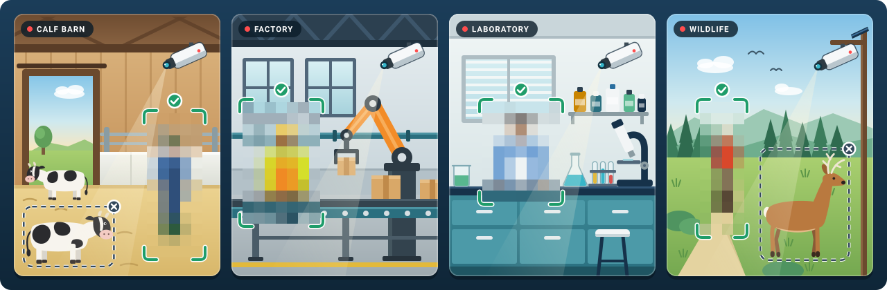
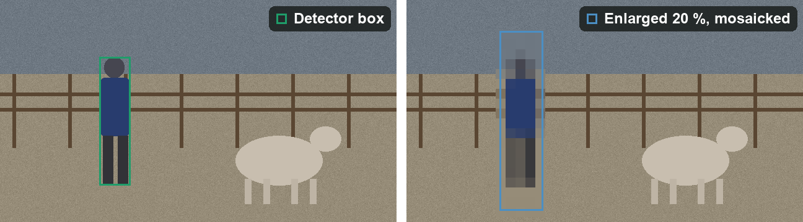
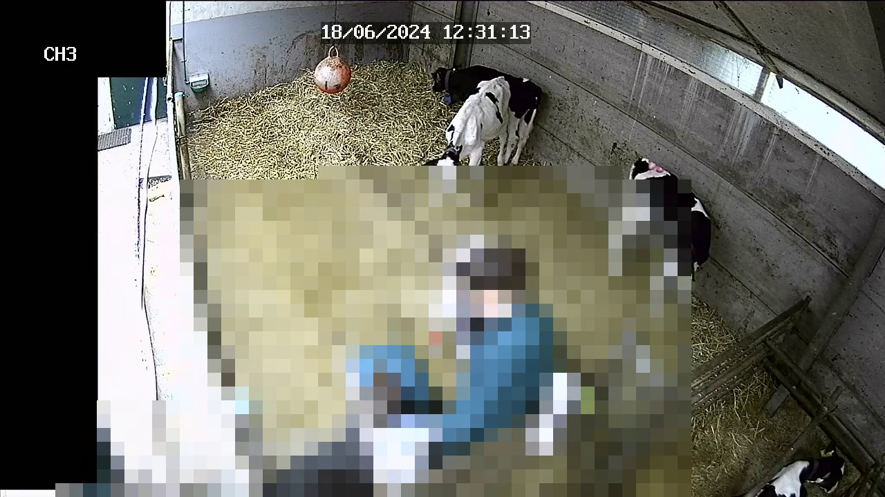
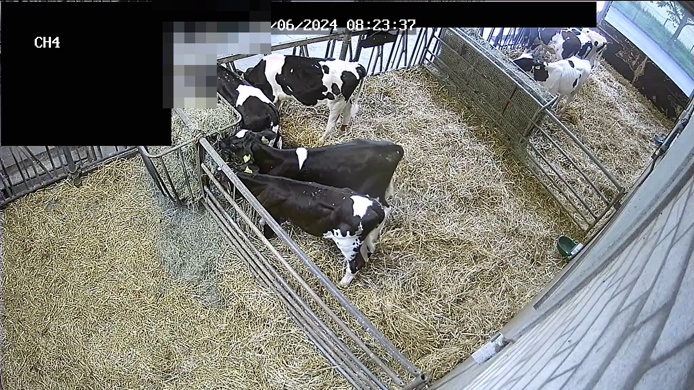
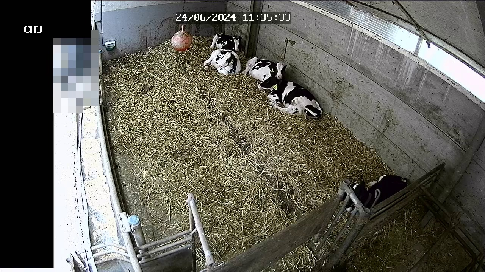
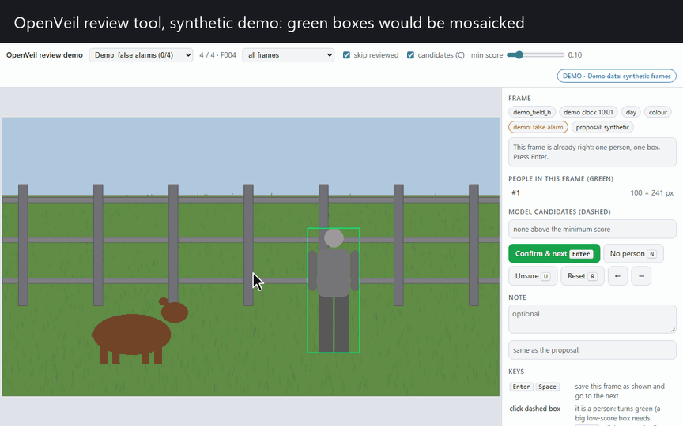

<p align="center">
  
</p>

<h1 align="center">Share your video dataset, not the people in it</h1>

<p align="center"><b>OpenVeil</b>: detect, verify and mosaic people in video datasets before release, with an interactive human review tool.</p>

<p align="center">
  <a href="https://sonam525.github.io/OpenVeil/"></a>
  <a href="https://huggingface.co/Sonam5/OpenVeil-Verifier-DINOv3-ViT-L16"></a>
  <a href="https://huggingface.co/datasets/Sonam5/Calf-Play-Behavior-Dataset"></a>
  <a href="LICENSE"></a>
  <a href="pyproject.toml"></a>
</p>

<p align="center">
  <a href="#how-it-works">How it works</a> ·
  <a href="#results">Results</a> ·
  <a href="#examples">Examples</a> ·
  <a href="#review-tool">Review tool</a> ·
  <a href="#quick-start">Quick start</a> ·
  <a href="#weights">Weights</a> ·
  <a href="#licences">Licences</a> ·
  <a href="#citing-openveil">Citing</a>
</p>

Video from farms, factories and laboratories is worth sharing beyond the study that recorded it: others can train detectors on it or pre-train video models with it. The same footage also shows staff and visitors, who have to be hidden before release. Face blurring does not hide them, because people at work are seen from above, from behind, or only as a pair of boots behind a wall. A single whole-body detector either misses people or puts mosaics on what the footage was recorded to show (in our case study, the calves). Nobody can check millions of frames by eye.

OpenVeil is an open-source tool for this problem. It does not ask one detector to be perfect. Grounding DINO, an open-vocabulary detector, proposes person boxes at a threshold low enough to miss almost no one (the proposer). A DINOv3 classifier (the verifier) looks at each proposed crop and rejects the false proposals. A person then corrects the boxes on the frames where errors are most likely, in a review tool that runs on their own computer. In the released video each person is covered by a mosaic of coarse blocks.

OpenVeil is meant for any footage in which people have to be hidden and something else is the subject: farms, factories, laboratories, warehouses, wildlife cameras. So far it has been tested on one case study, a public calf-behaviour dataset of 1,173 videos (50.8 million frames) from calf barns on two dairy farms. The figures below come from that case study; we have no results for other kinds of footage. For other footage the released weights are only a starting point: you review frames of your own footage and set your own threshold (see [Other footage](#other-footage)).

- **All 172 people covered on the test set.** The test set is 731 human-checked frames of everyday footage, 52 of them with people. A person counts as covered when at least 90 % of their box lies under the mosaic boxes. People missed by both the pipeline and the reviewer are not counted (see [Results](#results)).
- **Few false mosaics.** A false box is a mosaic box that is not on a person. OpenVeil put one on 3.3 % of everyday frames, and a big one (at least 15 % of the image) on 0.45 %.
- **No single detector did as well.** When each alternative detector was limited to the same 3.3 % of frames with a false box, the best of them (a YOLO11l fine-tuned on the training set) covered 126 of the 172 people, and Grounding DINO alone covered 71. A face detector found a face for only 66 people.
- **Little compute, little review time.** The detector looked at about one frame in twenty (0.0508 detector calls per frame). In the case study it checked only one frame every 5 s at night; the default setting of the released code scans the night like the day and so needs more compute. The logged review of 3,194 frames took one person about 2.4 h, a median of 0.6 s per frame.
- **Most of the footage is left as it was.** Only 12.0 % of the packets (the compressed units of a video file) of the masked videos were re-encoded. Every other packet was copied unchanged, so those frames are exactly as recorded; this matters when annotations made on the original footage are applied to the masked files. Every masked video passed the automatic check against its source.

<p align="center"></p>
<p align="center"><sub>A frame of the released, masked case-study dataset (FarmA_R2), shown with the data owner's approval. A partly visible person only 40 x 29 px (0.13 % of the frame) was found and masked. The outline marks the mosaic, and the inset enlarges it 3x.</sub></p>

## How it works

**Propose broadly, then verify.** OpenVeil does not rely on one detector to make perfect predictions. A detector proposes person boxes at a low threshold, so that almost no person is missed. Many of its proposals are then not people (in the case study, many are calves). A classifier looks at each proposed crop and keeps only the people. A person reviews the frames where the pipeline is most likely to be wrong.

In the case study, OpenVeil covered all 172 people of the test set and put a false box on 3.3 % of frames. Grounding DINO alone, with its threshold raised until it also had a false box on at most 3.3 % of frames, covered 71 of the 172. The detector's score does not separate people from the other candidates well (AUC 0.713, where 1 is perfect and 0.5 is chance); the verifier's score does (AUC 0.994).

<p align="center">
  <picture>
    <source media="(max-width: 640px)" srcset="figures/pipeline_narrow.svg">
    
  </picture>
</p>

**1. Detect (GPU).** The detector does not look at every frame. It checks one frame per second; when it finds a person it goes back and scans every 0.2 s, until 2 s pass without one. On each scanned frame, Grounding DINO proposes boxes for the prompt `worker. person. cow. calf.`, and every box that scores at least 0.05 becomes a candidate. The verifier, a DINOv3 ViT-L/16 with a LoRA adapter and a small head, scores each candidate crop and keeps it when p(person) ≥ 0.10. Of two nearly identical boxes one is removed, and a loose box that contains two or more smaller boxes is shrunk to fit them. Short gaps between detector calls are filled by interpolation, and the result is one small box table per video. Detection stores boxes only and leaves the pixels untouched.

**2. Review (any laptop).** The review tool builds queues of frames where errors are likely: the largest mosaics, frames in which a very large box was dropped (the giant rule, step 3), random frames, and candidates just below the verifier threshold. The reviewer accepts a frame with one key, deletes a box on an animal with one key, and adds a missed person with one click on a candidate or by drawing a box. The corrections are exported as an overrides file.

**3. Apply (CPU).** The giant rule drops a box that covers at least 55 % of the image and contains at least two smaller boxes; such a box would otherwise blank most of the frame. Each remaining box is enlarged by 20 % per side and is also applied to the frames within 2 s before and after it (the hold), because a person is not detected in every frame in which they are visible. Every cell of a fixed grid that touches a box is filled with its mean colour. Only the groups of pictures (GOPs) that contain a masked frame are re-encoded (smart cut); every other packet is copied unchanged. An automatic check then confirms that each masked file has the same packet count and timestamps as its source and that every copied packet is byte-identical. Detection stored only boxes, so the giant rule, the enlargement, the hold and the reviewer's corrections can be changed and applied again without a GPU.

<p align="center"></p>
<p align="center"><sub>What the mosaic looks like, on a drawn, synthetic frame (no footage). Left: the detector box (green). Right: the box enlarged by 20 % per side (blue), and every pixel inside it set to the mean of its 16 px grid cell.</sub></p>

Every stage in detail: [docs/how_it_works.md](docs/how_it_works.md). Why this design: [docs/design_rationale.md](docs/design_rationale.md).

## Results

All results come from the case study: 1,173 videos (651 h, 50.8 million frames) of calf barns on two dairy farms, in colour by day and in infrared at night. The results use four sets of frames.

- **Everyday sample.** 2,000 frames drawn from 118 videos from which no training frame was taken.
- **Test set.** The 731 frames of the everyday sample in which one of the authors checked the proposals and drew a box round every person: 172 people in 52 frames. Rates measured on the test set are weighted so that they describe the whole everyday sample.
- **Validation set.** 261 frames with 145 people, chosen to contain hard cases, so it is harder than everyday footage. Agents running a large language model (LLM) pre-labelled it, and one of the authors then reviewed every frame.
- **Training set.** 3,004 frames from other videos, pre-labelled by LLM agents and all reviewed by one of the authors. The verifier was trained on it.

| Measure | Result | Measured on |
|:---|:---|:---|
| People covered (≥ 90 % of their box under the mosaic boxes) | **172 of 172** | Test set |
| Frames with a false box | **3.3 %** (0.45 % with a big one, ≥ 15 % of the image) | Test set, weighted to the everyday sample |
| Frame area under false boxes | **0.39 %** | Test set, weighted to the everyday sample |
| People covered when the whole pipeline is run on video (scan schedule, hold and enlargement included) | **140 of 145** | Validation set; the pipeline was run again on the stored model output of its source clips |
| Loose recall of the whole pipeline | **0.862** | Validation set, same run |
| Person-free frames that receive some mosaic | **28.2 %** (1.07 % of their area) | The 142 person-free frames of the validation set, same run |
| Detector calls | **0.0508 per frame** | Whole dataset, `clock` policy: one check every 5 s at night |
| Frames carrying a mosaic | **6.8 %** of video frames; 11.7 % of the 1,106,110 still frames (JPEG) that the dataset also contains | Whole release |
| Video packets re-encoded | **12.0 %**, all others copied unchanged | The 1,023 masked videos; the other 150 are byte-identical to the source |
| Masked videos passing the automatic check | **all** | The 1,023 masked videos |
| Human review | **about 2.4 h** for 3,194 frames, 0.6 s median per frame | Review log (logged decisions), one reviewer |

**How to read these figures**

- **Definitions.** A person is covered when at least 90 % of their box lies under the mosaic boxes, each enlarged by 20 % per side as in masking. A false box is a box with less than 20 % of its area on any one person. Loose recall counts a person as found when any box matches (IoU ≥ 0.5) a box drawn on any part of them.
- **Single frames and whole pipeline.** The test-set figures are a single-frame test: detector, verifier and box rules on each frame by itself. The validation figures add the scan schedule, the hold and the enlargement. The 28.2 % cannot be compared with the 3.3 %: it is measured on the validation set, which was chosen to contain hard cases, and after the hold and the enlargement, which also put mosaic on frames without people.
- **The test-set boxes were not drawn independently.** The reviewer drew them while checking the pipeline's own proposals, so a person missed by both the pipeline and the reviewer is not counted.
- **The verifier scores on the test set are cross-fitted.** Each test frame was scored by a model that had not seen its video but was trained on the other half of the test videos.
- **The threshold was chosen with knowledge of the test set.** The threshold of 0.10 was chosen after we had seen results on the test set.
- **Infrared.** No infrared frame of the test set shows a person, so coverage in infrared could not be measured.
- **Not a zero miss rate.** Covering all 172 people does not show that the miss rate is zero: the one-sided 95 % upper bound is about 1.7 % per person.
- **The validation figures are not independent of the training data either.** The released verifier was trained on other minutes of most of the same videos.
- **Review time.** The 2.4 h are the logged decisions. The tool writes a log line only when a frame is saved: 622 of the 3,004 training frames have one, and the other 2,382 needed no change. The review of the validation set is not in this log.

More detail: [docs/case_study.md](docs/case_study.md).

**Single detectors compared with OpenVeil.** At its lowest threshold Grounding DINO covered all 172 people of the test set, but then every frame had a false box. At a threshold high enough to bring its false boxes down to OpenVeil's 3.3 % of frames, it covered 71. Every detector we compared behaved in this way: it either left people uncovered or put false boxes on many frames. The table shows each method twice: at the threshold where it covered the most people, and at the threshold where it had a false box on at most 3.3 % of frames, as OpenVeil had.

| Method | Most people covered at any threshold, of 172 (share of frames with a false box at that threshold) | People covered when false boxes are limited to 3.3 % of frames |
|:---|:---|:---|
| Face detector (RetinaFace), face box | 0 | 0 |
| Face detector (RetinaFace), body box drawn from the face | 34 (22.6 %) | 16 |
| YOLO11x, pre-trained on COCO | 137 (51.0 %) | 82 |
| YOLO11l, fine-tuned on the training set | 128 (5.0 %) | 126 |
| OWLv2, prompt "a person" | 142 (52.7 %) | 35 |
| LocateAnything-3B | 151 (50.9 %) | no score, so no threshold to set |
| Grounding DINO alone | 172 (100 %) | 71 |
| **OpenVeil: Grounding DINO with the verifier at 0.10** | **172 (3.3 %)** | **172** |

All methods were scored on the test set by the same rules as above. Each detector is shown at the threshold that covered the most people within the limit, chosen on the test set in its favour. The face detector found a face for 66 of the 172 people, but a face is a small part of a person and no face box covered anyone. The comparison favours methods built on Grounding DINO: 168 of the 172 test-set boxes are Grounding DINO candidates that the reviewer adopted, so the 90 % rule is strict for detectors whose boxes have other shapes. The fine-tuned YOLO11l mostly misses parts of people, not whole people: at a threshold of 0.02 its boxes covered at least half of the box of 163 people. The training data favour the verifier as well: YOLO11l was fine-tuned on the labels before their review and saw no test-set video, whereas each cross-fitted verifier was trained on the reviewed labels and on half of the test-set videos. The earlier approaches and the development trials are in [docs/design_rationale.md](docs/design_rationale.md).

**Limits.** OpenVeil is not a guarantee. It has been tested on four recordings from two farms with similar barns and cameras. Its coverage figure counts only the people whom the pipeline or the reviewer found. The 172 people of the test set appear in only 52 frames, all in colour, and coverage in infrared could not be measured. The false-box rate depends on how the threshold is set. When we set the threshold by rules that did not use the frames on which the result was scored, 170 to 172 of the 172 people were covered, but the share of frames with a false box ranged from 1.5 % to 100 %, depending on the rule. The released verifier weights were trained on calf-barn footage only, so [other footage](#other-footage) needs its own reviewed frames and its own threshold. **Human review remains necessary** before any release, and a private way to report a missed person is strongly recommended. OpenVeil masks pixels only, not audio, metadata or burned-in text. All limits: [docs/limitations.md](docs/limitations.md).

## Examples

Frames of the released (masked) case-study dataset, shown with the data owner's approval; no unmasked person is shown. The last five frames come from three of the four recordings (FarmA_R3, FarmA_R2 and FarmB_R1) and include hard cases: small or partly visible people that the pipeline found and masked. In these five frames a human reviewer confirmed that every person is covered and did not have to add a box.

<table>
  <tr>
    <td width="50%" valign="top"><a href="docs/img/example_farmA_1.jpg"></a><br><sub>Farm A, a frame of the released dataset after masking</sub></td>
    <td width="50%" valign="top"><a href="docs/img/example_farmA_2.jpg"></a><br><sub>Farm A, a second frame of the released dataset after masking</sub></td>
  </tr>
  <tr>
    <td width="50%" valign="top"><a href="docs/img/example_farmB_1.jpg"></a><br><sub>Farm B, a frame of the released dataset after masking</sub></td>
    <td width="50%" valign="top"><a href="docs/img/example_farmA_r3.jpg"></a><br><sub>FarmA_R3: two people masked (1920 x 1080 frame)</sub></td>
  </tr>
  <tr>
    <td width="50%" valign="top"><a href="docs/img/example_farmA_r2_small.jpg"></a><br><sub>FarmA_R2: one partly visible person only 40 x 29 px (0.13 % of the frame), found and masked</sub></td>
    <td width="50%" valign="top"><a href="docs/img/example_farmA_r2_small_annotated.jpg"></a><br><sub>The same frame: the outline marks the mosaic, and the inset enlarges it 3x</sub></td>
  </tr>
  <tr>
    <td width="50%" valign="top"><a href="docs/img/example_farmA_r2_lowscore.jpg"></a><br><sub>FarmA_R2: a partly visible person, 29 x 58 px (0.18 % of the frame); the proposer scored it only 0.25 in a separate scan, yet the verifier kept it and it was masked</sub></td>
    <td width="50%" valign="top"><a href="docs/img/example_farmB_small.jpg"></a><br><sub>FarmB_R1: a partly visible person, 47 x 84 px (0.43 % of the frame), found and masked</sub></td>
  </tr>
</table>

## Review tool

The review tool is one web page, served by a small Python program on your own computer, so the frames never leave it. The recording below (45 s, no sound) shows a reviewer working through frames of the built-in demo, which uses drawn frames and no real people.

<p align="center"><a href="https://sonam525.github.io/OpenVeil/#review"></a></p>
<p align="center"><sub>In order: a correct proposal is accepted with <code>Enter</code>; a box on a calf is deleted with <code>X</code>; a missed person is added with one click on a dashed candidate, and a second one by drawing a box; the magnifier is held over a figure half hidden behind a fence; a frame is marked unsure, with a note; and a loose box is resized by its handles. The <a href="https://sonam525.github.io/OpenVeil/#review">project page</a> has the same recording as a video that can be paused.</sub></p>

Green boxes are the people the pipeline proposes; dashed boxes are the model's other candidates with their scores. The aim is the same for every frame: each visible person has one box, and nothing else has one. Press `Enter` when a frame is right; click a candidate to adopt it, drag to draw or move a box, `X` to delete, `N` for nobody, `U` for unsure, hold `Z` for a magnifier. Every save is written to disk at once. The server listens on 127.0.0.1 only; the review folder holds unmasked frames, so never share it.

Try it yourself with `openveil review demo`, which needs no GPU and no data. The demo opens with a few frames already reviewed; untick "skip reviewed" to see them too. Step-by-step tutorial with screenshots: [docs/review_tool.md](docs/review_tool.md).

## Quick start

OpenVeil needs Python 3.10 or newer. Detection runs best on a CUDA GPU; `--device cpu` works but is slow. Detection needs two things that you fetch yourself: the gated DINOv3 ViT-L/16 base model, for which you accept Meta's DINOv3 License on its Hugging Face page and run `huggingface-cli login`, and the [verifier weights](#weights). Grounding DINO is downloaded automatically. Review and apply need no GPU.

```bash
git clone https://github.com/Sonam525/OpenVeil.git openveil && cd openveil
pip install -e ".[video,detect,review]"
```

```bash
openveil review demo                     # try the review tool on synthetic frames, port 8766
openveil detect videos/*.mp4 --out tables/ --config my_config.yaml --device cuda
openveil review build --tables tables/ --videos videos/ --out review/
openveil review serve review/            # open http://127.0.0.1:8765, then export:
openveil review export review/ --overrides overrides.json
openveil apply video videos/cam1.mp4 --table tables/cam1.json.gz \
    --out masked/cam1.mp4 --overrides overrides.json
openveil verify videos/cam1.mp4 masked/cam1.mp4
```

Every command and option, still images and tar shards, the extras, a config file and the model-free trial run: [docs/usage.md](docs/usage.md). Every setting of the `production` preset: [docs/configuration.md](docs/configuration.md).

The defaults are the evaluated case-study settings, including the Grounding DINO prompt `worker. person. cow. calf.` that the verifier was trained with; only the day/night policy differs (`always_full`, a full scan day and night). The prompt names the barn animals for two reasons: the detector can then label a box round an animal as `cow` or `calf` and not as a person, and the animal candidates served as examples of "not a person" when the verifier was trained. For other footage, change these two words (see [Other footage](#other-footage)).

### Other footage

The code and the procedure carry over to other footage. The released verifier weights are only a starting point there, because they were trained on calf-barn crops. For a new dataset:

1. Run detection with the released verifier and the default policy, `always_full`, which scans day and night in the same way.
2. Review the queues that OpenVeil builds: the largest mosaics, random frames and candidates just below the verifier threshold.
3. If the review finds false alarms or misses, set a new verifier threshold (`verifier.threshold`) on your reviewed frames, or train a new adapter on them (training took 35 min on one A10 GPU in the case study). How many reviewed frames another kind of footage needs has not been tested; the case-study verifier was trained on about 3,000 reviewed frames plus the 731 frames of the test set.
4. Apply the mask plan and the corrections, then have a person check a random sample of the masked frames.

For footage with other animals or with machines, replace `cow` and `calf` in the prompt (for example `worker. person. horse.`) and check the verifier on reviewed frames. Keep the frames you use to evaluate the verifier out of its training. The commands for each step are in [docs/usage.md](docs/usage.md#other-footage-than-calf-barns).

## Weights

**Built with DINOv3.** The crop verifier of the case study, a LoRA adapter (rank 32) and an MLP head on DINOv3 ViT-L/16, is at [`Sonam5/OpenVeil-Verifier-DINOv3-ViT-L16`](https://huggingface.co/Sonam5/OpenVeil-Verifier-DINOv3-ViT-L16) under the DINOv3 License, not Apache-2.0. The DINOv3 backbone is not included: download it yourself from Meta's gated repository. The verifier was trained on calf-barn footage only; for other footage it is a starting point (see [Other footage](#other-footage)). The [model card](docs/model_card.md) lists the training data, the metrics and the limits.

```python
from huggingface_hub import snapshot_download

snapshot_download("Sonam5/OpenVeil-Verifier-DINOv3-ViT-L16",
                  local_dir="weights/OpenVeil-Verifier-DINOv3-ViT-L16")
```

Then set `verifier.adapter_dir` to that folder. Checksums, tested library versions (`transformers` < 5) and troubleshooting: [docs/usage.md](docs/usage.md#verifier-weights).

## Repository layout

| Path | What it holds |
|:---|:---|
| [`openveil/`](openveil) | The Python package: detection, review tool, masking, verifier training |
| [`configs/`](configs) | The `production` preset written out with comments, and an example barn config |
| [`docs/`](docs) | The documentation below, and the project page |
| [`docs/img/`](docs/img/README.md) | Review-tool screenshots and screen recording (synthetic), the mosaic drawing and the approved masked stills |
| [`figures/`](figures) | The banner and the pipeline figures with the script that draws them, and the script that records the review-tool demo |
| [`tests/`](tests) | Tests on synthetic data: `python -B -m unittest discover -s tests` |
| [`CITATION.cff`](CITATION.cff), [`.zenodo.json`](.zenodo.json), [`CHANGELOG.md`](CHANGELOG.md) | Citation and release metadata, and the changes in each release |

### Documentation

| Page | Content |
|:---|:---|
| [docs/usage.md](docs/usage.md) | Install and extras, every command, still images, config files, verifier weights |
| [docs/configuration.md](docs/configuration.md) | Every setting of the `production` preset |
| [docs/how_it_works.md](docs/how_it_works.md) | Every pipeline stage, the box-table format, smart cut |
| [docs/design_rationale.md](docs/design_rationale.md) | What we tried during development, and why the final design |
| [docs/review_tool.md](docs/review_tool.md) | Review-tool tutorial with screenshots and key reference |
| [docs/case_study.md](docs/case_study.md) | The calf play-behaviour dataset: detection, review and release numbers |
| [docs/model_card.md](docs/model_card.md) | The crop verifier: data, training, metrics, limits, licence |
| [docs/limitations.md](docs/limitations.md) | What OpenVeil does not guarantee |
| [THIRD_PARTY.md](THIRD_PARTY.md) | Third-party licences |

## Licences

| Item | Terms |
|:---|:---|
| Code in this repository | Apache-2.0, see [`LICENSE`](LICENSE) and [`NOTICE`](NOTICE) |
| [Verifier weights](https://huggingface.co/Sonam5/OpenVeil-Verifier-DINOv3-ViT-L16) | DINOv3 License, published separately with a copy of it. Not Apache-2.0 |
| DINOv3 ViT-L/16 base model | DINOv3 License, gated with manual approval by Meta. Download it yourself |
| Grounding DINO base | Apache-2.0, downloaded at run time |
| FFmpeg, x264, x265 | Reached through PyAV, which you install; its wheels bundle FFmpeg linked with x264 and x265 (GPL-2.0-or-later). Not redistributed here; your masked outputs are not GPL |

**Built with DINOv3**: Meta's licence requires prominently displaying this, and publications of results must acknowledge DINOv3. The DINOv3 License also restricts some uses, for example end uses prohibited by trade controls. Encoding H.264/HEVC may need patent licences for commercial use. Details: [THIRD_PARTY.md](THIRD_PARTY.md). This is not legal advice.

## Authors

- **Haiyu Yang** ([ORCID 0009-0007-5125-4958](https://orcid.org/0009-0007-5125-4958)), Department of Animal Science, College of Agriculture and Life Sciences, Cornell University, Ithaca, NY, USA
- **Miel Hostens** ([ORCID 0000-0001-5376-976X](https://orcid.org/0000-0001-5376-976X)), Department of Animal Science, College of Agriculture and Life Sciences, Cornell University, Ithaca, NY, USA

## Citing OpenVeil

Each OpenVeil release is archived on [Zenodo](https://zenodo.org), which assigns it a version DOI.

**Release:** 1.1.0 (2026-11-24). What changed in each release: [CHANGELOG.md](CHANGELOG.md).

[](https://doi.org/10.5281/zenodo.24505557)

The concept DOI [10.5281/zenodo.24505557](https://doi.org/10.5281/zenodo.24505557) cites all versions and resolves to the latest one; the version DOI of each release is on its Zenodo record.

Please cite the concept DOI, or the version DOI of the version you used; [`CITATION.cff`](CITATION.cff) holds the same metadata (GitHub's "Cite this repository" button reads it). An arXiv preprint describing OpenVeil is forthcoming, and `CITATION.cff` will then be updated with its reference. Until then:

> Yang, H., & Hostens, M. (2026). *OpenVeil: Detect, verify and mosaic people in video datasets before release, with an interactive human review tool* (Version 1.1.0) [Computer software]. Zenodo. https://doi.org/10.5281/zenodo.24505557

If you use the verifier weights, please also cite DINOv3 (arXiv:2508.10104); the DINOv3 License requires acknowledging it. The case-study data are the [Calf Play Behavior Dataset](https://huggingface.co/datasets/Sonam5/Calf-Play-Behavior-Dataset), version 1.2 (the masked release, made with OpenVeil; DOI [10.57967/hf/11689](https://doi.org/10.57967/hf/11689)). The dataset is described in a data descriptor ([arXiv:2611.21706](https://arxiv.org/abs/2611.21706), under review at Scientific Data). Both are in the BibTeX below.

<details>
<summary>BibTeX</summary>

```bibtex
@software{yang2026openveil,
  author    = {Yang, Haiyu and Hostens, Miel},
  title     = {{OpenVeil}: Detect, verify and mosaic people in video datasets
               before release, with an interactive human review tool},
  version   = {1.1.0},
  year      = {2026},
  publisher = {Zenodo},
  doi       = {10.5281/zenodo.24505557},
  url       = {https://github.com/Sonam525/OpenVeil},
  license   = {Apache-2.0}
}

@misc{simeoni2025dinov3,
  title         = {{DINOv3}},
  author        = {Sim{\'e}oni, Oriane and Vo, Huy V. and Seitzer, Maximilian and
                   Baldassarre, Federico and Oquab, Maxime and Jose, Cijo and
                   Khalidov, Vasil and Szafraniec, Marc and Yi, Seungeun and
                   Ramamonjisoa, Micha{\"e}l and Massa, Francisco and
                   Haziza, Daniel and Wehrstedt, Luca and Wang, Jianyuan and
                   Darcet, Timoth{\'e}e and Moutakanni, Th{\'e}o and
                   Sentana, Leonel and Roberts, Claire and Vedaldi, Andrea and
                   Tolan, Jamie and Brandt, John and Couprie, Camille and
                   Mairal, Julien and J{\'e}gou, Herv{\'e} and Labatut, Patrick and
                   Bojanowski, Piotr},
  year          = {2025},
  eprint        = {2508.10104},
  archivePrefix = {arXiv},
  primaryClass  = {cs.CV},
  url           = {https://arxiv.org/abs/2508.10104}
}

@misc{yang2026calfplaydata,
  title     = {{Calf-Play-Behavior-Dataset}},
  author    = {Yang, Haiyu and Lesscher, Heidi and Liu, Enhong and Hostens, Miel},
  year      = {2026},
  version   = {1.2},
  publisher = {Hugging Face},
  doi       = {10.57967/hf/11689},
  url       = {https://huggingface.co/datasets/Sonam5/Calf-Play-Behavior-Dataset}
}

@misc{yang2026calfplay,
  title         = {Video recordings and play behaviour annotations of group-housed dairy calves on two {Dutch} farms},
  author        = {Yang, Haiyu and Lesscher, Heidi and Liu, Enhong and Hostens, Miel},
  year          = {2026},
  eprint        = {2611.21706},
  archivePrefix = {arXiv},
  primaryClass  = {cs.CV},
  url           = {https://arxiv.org/abs/2611.21706}
}
```

</details>
