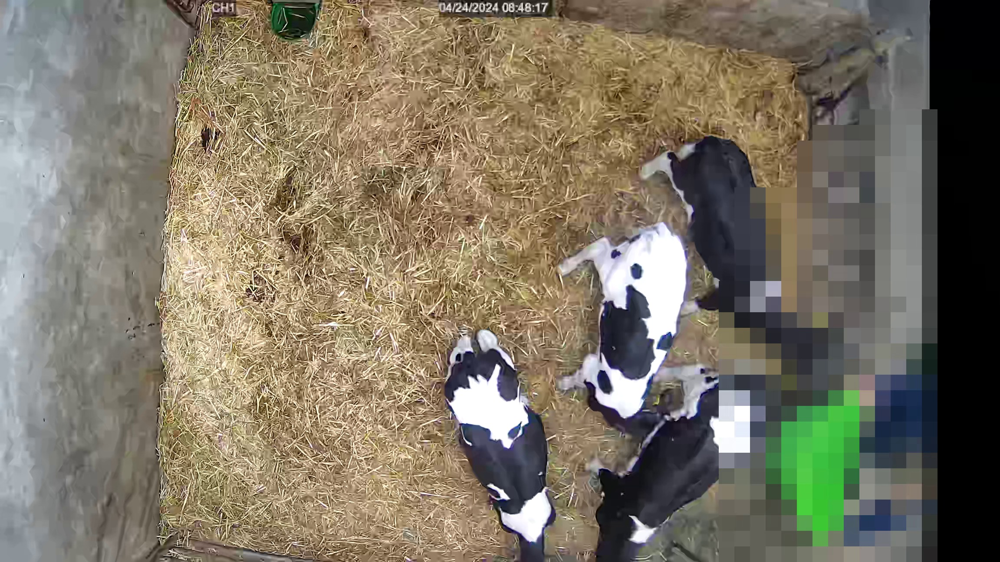
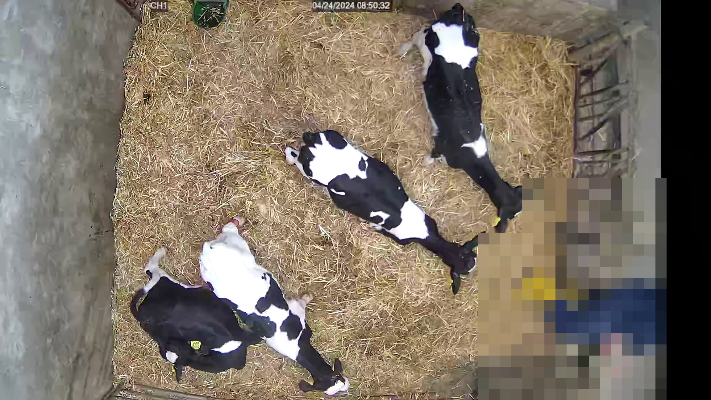

# OpenVeil

**Detect, verify and mosaic people in video datasets before release, with an
interactive human review tool.**

Researchers want to share their video datasets: animal behaviour, agriculture,
wildlife, laboratory work, traffic. But the footage often shows staff, visitors
or bystanders with recognisable faces and bodies, and that blocks open release
(privacy law, consent, institutional rules). Masking people by hand in
thousands of hours of video is not feasible, and off-the-shelf detectors either
miss people in odd poses or put mosaics all over the animals you want to study.

OpenVeil is built to find every person (recall first), lets a human verify the
hard cases, and mosaics the people while touching as little of the footage as
possible: only the groups of
pictures (GOPs) that contain a mosaic are re-encoded, and every other packet is
copied bit for bit.

- **Recall first.** An open-vocabulary detector (Grounding DINO: it finds the
  objects named in a text prompt) proposes boxes at a low threshold; a
  fine-tuned crop classifier (a model that looks at each proposed box cut out of
  the frame: DINOv3 with LoRA, a small trainable add-on to a large model)
  removes the false alarms.
- **Cheap to run.** A sparse-then-dense schedule ran the detector on about 1 in
  20 frames in the case study (with the `clock` day/night policy, sparse at
  night; the default `always_full` policy makes more calls).
- **Human in the loop.** A fast, local review tool for the frames that matter,
  whose corrections flow straight back into the masking step.
- **Minimal footprint.** Smart cut re-encodes only what changes and verifies
  every output file automatically.
- **Inspectable.** Detection writes small box tables; every rule after that can
  be changed and re-applied without a GPU.

> **Status:** version 0.1.0. An arXiv preprint describing OpenVeil is
> forthcoming. The code is Apache-2.0. The trained crop-verifier weights are
> published separately on the Hugging Face Hub as
> [`Sonam5/OpenVeil-Verifier-DINOv3-ViT-L16`](https://huggingface.co/Sonam5/OpenVeil-Verifier-DINOv3-ViT-L16) under the
> DINOv3 License (see [Verifier weights](#verifier-weights)). **Built with DINOv3.**

## Contents

- [How it works](#how-it-works)
- [Results](#results)
- [Quickstart](#quickstart)
- [Verifier weights](#verifier-weights)
- [The review tool](#the-review-tool)
- [Configuration reference](#configuration-reference)
- [Why this design](#why-this-design)
- [Limitations](#limitations)
- [Licences](#licences)
- [Documentation](#documentation)
- [Authors](#authors)
- [Citation](#citation)

## How it works

```mermaid
flowchart LR
    V["Videos"] --> S["Scan schedule<br/>1 s checkpoints,<br/>0.2 s dense after a hit"]
    S --> P["Proposer<br/>Grounding DINO<br/>score >= 0.05"]
    P --> C["Verifier<br/>DINOv3 crop classifier<br/>p(person) >= 0.10"]
    C --> I["Box rules +<br/>gap interpolation"]
    I --> T[("Box tables<br/>.json.gz")]
    T --> R["Review tool<br/>(human)"]
    R --> O[("overrides.json")]
    T --> M["Mask plan<br/>giant rule, +20%, hold 2 s"]
    O --> M
    M --> X["Mosaic + smart cut<br/>re-encode only GOPs<br/>with a mosaic"]
    X --> Q["Verify"]
    Q --> OUT["Masked videos<br/>and images"]
```



1. **Detect** (GPU). Videos are decoded in 60 s chunks. A checkpoint runs every
   second; after a hit the detector runs every 0.2 s until the scene is clear for
   2 s. Grounding DINO proposes candidate boxes, and a DINOv3 crop classifier
   keeps those that show a person. Duplicates and loose group boxes are tidied,
   and short gaps between detections are interpolated. The result is one box
   table per video.
2. **Review** (any laptop). The review tool shows the frames most likely to be
   wrong: largest mosaics, giant-rule episodes and a random sample (plus
   below-threshold candidates when the boxes come with them; `openveil detect`
   tables do not store them). A reviewer fixes boxes with the mouse and
   keyboard; the corrections are exported as an overrides file.
3. **Apply** (CPU). Each box is enlarged by 20% per side and held for ±2 s,
   cells of a fixed grid that touch a box are replaced by their mean colour, and
   only the affected GOPs are re-encoded. Every output is checked against its
   source.

Details of every stage: [docs/how_it_works.md](docs/how_it_works.md).

## Results

From the case study, a calf play-behaviour dataset of 1,173 videos (about
50.8 million frames) from two farms ([docs/case_study.md](docs/case_study.md)).

| Measure | Result | Evaluation set |
|---|---|---|
| People covered (≥ 90% of their area under a mosaic) | **172 / 172** | 731 everyday frames checked by a human (HUM731; 52 frames with people) |
| Frames with a false mosaic box | **3.3%** (0.4% with a big one, ≥ 15% of the image) | HUM731, weighted to 2,000 sampled everyday frames |
| Recall on hard validation frames | **0.862** (loose matching¹) | 261 validation frames enriched with partial and missed people (VAL261), full pipeline with the production schedule; scored by the released model² |
| False mosaic area | **0.22%** of frame area | VAL261 schedule replay² |
| Detector calls | **0.0508 per frame** | whole dataset, `clock` day/night policy (sparse at night) |
| Frames carrying a mosaic in the release | **6.8%** of all video frames (7.7% of the frames of the 1,023 masked videos), 11.7% of JPEG frames | whole dataset (50.8 M video frames; all 1,106,110 JPEGs) |
| Video packets re-encoded | **12.0%**; all others copied bit-exact | 1,023 masked videos |
| Masked files passing the automatic check | **all** | 1,023 videos, 270 frame shards |
| Human review speed | **0.6 s** median per frame; 3,194 frames in about 2.4 h | all review queues |

¹ Loose matching: a person counts as found if any mosaic box matches (IoU ≥ 0.5,
IoU being the overlap of two boxes from 0 to 1) a box drawn on any part of
them, so a box on a hand counts. It is lenient; see
[design_rationale.md](docs/design_rationale.md#2-how-we-measured).
² Scored by the released model, whose training data include other minutes of
most of the same source videos (no overlapping frames): not a held-out
estimate. HUM731 is scored by a model trained without its videos.

Compared with the alternatives we tried, the final cascade was the only option
that combined full coverage of people in everyday frames with a low false-mosaic
rate (see [Why this design](#why-this-design)).

**What the mosaic looks like** (a drawn, synthetic frame; no footage):


**Example outcomes in the case study.** Frames of the released (masked) dataset,
shown with the data owner's approval; no unmasked person is shown.

|  |  |  |
|---|---|---|
| Farm A, a frame of the released dataset after masking | Farm A, a second frame of the released dataset after masking | Farm B, a frame of the released dataset after masking |

Further examples (Farm A recordings FarmA_R2 and FarmA_R3, and frames with
small, hard-to-see people that were found and masked) are being selected; each
is added only after a person has checked it by eye for anyone left unmasked.

The outcomes in numbers (from [docs/case_study.md](docs/case_study.md)):

| Case | Outcome |
|---|---|
| Workers in everyday frames (HUM731) | all 172 people in the 52 frames with people covered by the mosaic |
| Legs and boots behind a pen wall, people at the image edge | the hardest cases (see [Limitations](#limitations)); VAL261 is enriched with them, and 14% of its people are not found under loose matching |
| Calves and objects mistaken for people | false mosaics on animals and objects: 3.3% of everyday frames keep one, 0.4% a big one (≥ 15% of the image) |
| Infrared night frames | detected with the same models; recall with people at night was not measured |

## Quickstart

### Install

OpenVeil needs Python ≥ 3.10. The core needs only numpy; the rest comes in
extras.

```bash
git clone https://github.com/Sonam525/OpenVeil.git openveil && cd openveil
pip install -e ".[video,detect]"      # detection and video masking
```

| Extra | Installs | Needed for |
|---|---|---|
| `video` | av, scipy | `apply video`, `verify` (scipy: optimal matching for interpolation; greedy without it) |
| `detect` | torch, transformers, peft, accelerate, safetensors, pillow, av, scipy, pyyaml | `detect` |
| `train` | `detect` + scikit-learn | training the crop verifier |
| `images` | pillow | `apply images` (OpenCV is used instead when it is installed) |
| `review` | av, pillow | `review demo` (Pillow) and `review build --videos` (PyAV) |
| `yaml` | pyyaml | YAML config files (JSON needs nothing) |
| `dev` | `video`, `images`, `review`, `yaml` | the full test suite |

Detection needs the Grounding DINO base model (downloaded automatically) and,
for the crop verifier, the DINOv3 ViT-L/16 base model, which is **gated**:
accept Meta's DINOv3 License on its Hugging Face page and log in
(`huggingface-cli login`) first. You also need the verifier weights (see
[Verifier weights](#verifier-weights)), or your own, or set the verifier mode to
`none`. A CUDA GPU is strongly recommended for detection; review and apply run
on a CPU (`--device cpu` runs detection on a CPU too, slowly).

### Try the review tool first (no GPU, no data)

```bash
pip install -e ".[review]"           # Pillow draws the synthetic frames
openveil review demo                 # synthetic frames, port 8766
```

Open <http://127.0.0.1:8766> and follow the
[review tutorial](docs/review_tool.md).

### Mask your own videos

```bash
# 0. Look at the settings (the production preset is the default)
openveil config show --preset production

# 1. Detect people: one box table per video (<name>.json.gz)
openveil detect videos/*.mp4 --out tables/ --config my_config.yaml --workers 2 --device cuda

# 2. List where the giant rule fires (frames worth reviewing)
openveil episodes tables/ --min-share 0.55

# 3. Review the hard cases in your browser, then export the corrections
openveil review build  --tables tables/ --videos videos/ --out review/ --per-queue 100
openveil review serve  review/ --port 8765          # open http://127.0.0.1:8765
openveil review export review/ --overrides overrides.json

# 4. Mask each video (smart cut) and check the result
openveil apply video videos/cam1.mp4 --table tables/cam1.json.gz --out masked/cam1.mp4 --overrides overrides.json
openveil verify videos/cam1.mp4 masked/cam1.mp4
```

Add `--full-reencode` to `apply video` to re-encode the whole file instead of a
smart cut. Without `--config`, `detect` uses `--preset production`, whose crop
verifier needs the verifier weights (`verifier.adapter_dir`); a missing package or
weights folder is reported before any video is touched. A video that failed
`run.max_attempts` times is skipped on later runs; `detect --retry-failed`
tries it again.

Smart cut (only GOPs with a mosaic re-encoded) needs H.264 or HEVC 8-bit 4:2:0
without B-frames and with the parameter sets in every keyframe (most cameras;
`ffmpeg ... -x264-params repeat-headers=1` for files you make yourself). Other
files are re-encoded in full; `apply video` prints why.

**Try the whole pipeline without any model.** The built-in stand-in detector
boxes bright regions (it finds no people; it is for trying the commands on a
test clip, for example a bright rectangle moving over a dark background):

```bash
openveil detect clip.mp4 --out tables/ --factory openveil.detect.fake:factory --device cpu
```

`--factory MODULE:FUNCTION` takes any function `f(cfg) -> (proposer, verifier)`;
the interface is described in [docs/how_it_works.md](docs/how_it_works.md#14-plugging-in-other-models).

### Mask still images

```bash
# a folder of JPEG/PNG images with proposed boxes per image (apply also takes a tar)
openveil review build  --images frames/ --boxes boxes.json --out review_images/
openveil review serve  review_images/
openveil review export review_images/
openveil apply images frames/ --boxes review_images/reviewed_boxes.json --out masked_frames/
```

`boxes.json` gives the boxes in pixels of the upright image (after any EXIF
orientation), for example

```json
{"cam1/0001.jpg": [[120, 40, 210, 300], [400, 80, 460, 260, "det", 0.42]],
 "cam1/0002.jpg": []}
```

A box is `[x1, y1, x2, y2]`, optionally followed by a kind and a score. A scored
box below 0.10 (`--accept`) is only a candidate: review shows it dashed and
`apply images` does not mask it. Names are matched exactly or, when unique,
ignoring letter case, a leading `./` and leading folders; boxes for a name that
matches no image make `apply images` fail and write nothing (`--allow-missing`
goes on). `reviewed_boxes.json` marks the boxes a reviewer confirmed as
`"manual"`, so the giant rule never drops them.

In a tar, only the images that get a mosaic are re-encoded (JPEG quality 95);
all other members stay byte-identical, with their names and order.

### A config file

A config file lists only what differs from the preset. This is the case-study
setup (see also `configs/example_barn.yaml`):

```yaml
preset: production
proposer:
  prompt: "worker. person. cow. calf."
  positive_phrases: [worker, person]
  competitor_phrases: [cow, calf]
verifier:
  adapter_dir: weights/OpenVeil-Verifier-DINOv3-ViT-L16                    # the downloaded weights
  head_path: weights/OpenVeil-Verifier-DINOv3-ViT-L16/head.safetensors
schedule:
  day_night:
    policy: clock          # day 06:00-23:00 by the camera clock, sparse at night
```

## Verifier weights

**Built with DINOv3.** The crop verifier used in the case study (a LoRA adapter
and an MLP head on top of DINOv3 ViT-L/16) is published on the Hugging Face Hub
as [`Sonam5/OpenVeil-Verifier-DINOv3-ViT-L16`](https://huggingface.co/Sonam5/OpenVeil-Verifier-DINOv3-ViT-L16).
Its model card lists the training data, the metrics with their evaluation sets,
and the limits.

| File | Content |
|---|---|
| `adapter_config.json`, `adapter_model.safetensors` | LoRA adapter (PEFT format, rank 32), 56.7 MB |
| `head.safetensors` | MLP head (1024 → 1024 → 512 → 2), 6.3 MB |
| `meta.json` | training recipe and preprocessing; OpenVeil checks `size` and `pad` at load |
| `SHA256SUMS` | checksums of the four files above |
| `LICENSE`, `NOTICE` | the DINOv3 License and the attribution |

**Licence.** The weights are a derivative of DINOv3 and are distributed under
the **DINOv3 License**, not under this repository's Apache-2.0 licence. The
DINOv3 backbone is not included and no merged model is provided: download it
yourself from Meta's gated repository
([`facebook/dinov3-vitl16-pretrain-lvd1689m`](https://huggingface.co/facebook/dinov3-vitl16-pretrain-lvd1689m)),
which means accepting the DINOv3 License. The licence restricts some uses (see
[Licences](#licences)).

**Download** (needs the `detect` extra, which brings `huggingface_hub`):

```python
from huggingface_hub import snapshot_download

snapshot_download("Sonam5/OpenVeil-Verifier-DINOv3-ViT-L16",
                  local_dir="weights/OpenVeil-Verifier-DINOv3-ViT-L16")
```

```bash
cd weights/OpenVeil-Verifier-DINOv3-ViT-L16 && sha256sum -c SHA256SUMS && cd -
```

Then point the verifier at the folder (the head is found there by name, so
`head_path` is optional):

```yaml
verifier:
  mode: crop
  adapter_dir: weights/OpenVeil-Verifier-DINOv3-ViT-L16
  head_path: weights/OpenVeil-Verifier-DINOv3-ViT-L16/head.safetensors
```

**Tested versions.** The weights were trained and checked with
`transformers` 4.57.1 and `peft` 0.13.2. `transformers` 5 renames the DINOv3
modules, so the adapter's keys no longer match; the `detect` extra therefore
requires `transformers>=4.56,<5`, and OpenVeil refuses to run an adapter whose
weights did not load. If a download crashes on Windows, setting
`HF_HUB_DISABLE_XET=1` (the classic download path of `huggingface_hub`) helped
in our tests.

## The review tool


A single local web page with a standard-library Python server. Green boxes are
the people the pipeline proposes (before the giant rule, the enlargement and the
hold); after review they are what you confirm. Dashed boxes are the model's
other candidates with their scores. Press `Enter` when a frame is right; click a candidate to adopt it,
drag to draw or move a box, `X` to delete, `N` for nobody, `U` for unsure,
hold `Z` for a magnifier. Every save is written to disk at once.

The server listens on 127.0.0.1 only, accepts only local host names, and
forbids other sites from embedding the page or its images. The review folder
holds unmasked frames: never share it.

Step-by-step tutorial with screenshots: [docs/review_tool.md](docs/review_tool.md).

## Configuration reference

Production values (the `production` preset). Print them all with
`openveil config show --preset production`; `configs/production.yaml` is the
same preset written out with comments. Unknown keys in a config file are
an error.

**Detection schedule** (`schedule`)

| Key | Value | Meaning |
|---|---|---|
| `chunk_s` | 60.0 | video is processed in chunks of this length (s) |
| `base_s` | 1.0 | checkpoint interval in full (day) mode (s) |
| `dense_s` | 0.2 | detector interval after a hit (s) |
| `clear_gaps` | 2 | checkpoint intervals without a hit before dense mode ends |
| `lookahead` | 4 | checkpoints per detector batch |
| `last_checkpoint` | true | last frame of every chunk is a checkpoint |
| `night_base_s` | 5.0 | checkpoint interval in sparse (night) mode; a hit never starts dense mode |
| `max_gap_s` | 3.0 | longest gap bridged by interpolation by day (s); at night `max(max_gap_s, night_gap_factor × night_base_s)` = 11 s |
| `night_gap_factor` | 2.2 | see above |
| `gate_base`, `gate_per_s` | 1.0, 1.5 | interpolation only if the boxes are within `gate_base + gate_per_s × gap` box sizes (or overlap, IoU > 0.05) |
| `day_night.policy` | `always_full` | `always_full`: day schedule everywhere. `clock`: by camera clock |
| `day_night.day_start`, `day_end` | 6, 23 | day hours for the `clock` policy |
| `day_night.margin_s` | 300 | a chunk is day if its start, or its end plus this margin, is in the day |
| `day_night.night_mode` | `sparse` | `sparse`, `skip` (no detection) or `full` |
| `day_night.clock_regex` | `(\d{8})[-_](\d{6})` | how to read the recording start from a file name |

**Proposer** (`proposer`)

| Key | Value | Meaning |
|---|---|---|
| `model_id` | `IDEA-Research/grounding-dino-base` | Grounding DINO model |
| `prompt` | `"person."` | text prompt (case study: `"worker. person. cow. calf."`) |
| `positive_phrases` | `[person]` | phrases whose score counts (case study: worker, person) |
| `competitor_phrases` | `[]` | phrases in the prompt that only absorb animals or objects (case study: cow, calf) |
| `shortest_edge`, `longest_edge` | 800, 1333 | model input size (px) |
| `fp16` | true | half-precision autocast |
| `batch` | 4 | frames per call; halved on out-of-memory |
| `cand_thr` | 0.05 | minimum score of a candidate |
| `merge_iou` | 0.6 | greedy NMS between candidates (non-maximum suppression: of boxes overlapping at IoU ≥ this, keep the best) |

**Verifier** (`verifier`)

| Key | Value | Meaning |
|---|---|---|
| `mode` | `crop` | `crop` (classifier) or `none` (keep by proposer score) |
| `backbone_id` | `facebook/dinov3-vitl16-pretrain-lvd1689m` | backbone (gated; DINOv3 License) |
| `adapter_dir`, `head_path` | – | the verifier weights ([Verifier weights](#verifier-weights)) |
| `size`, `pad` | 224, 0.10 | crop size (px) and context per side |
| `resize_width`, `jpeg_quality` | 1280, 90 | frame pre-processing, matching training |
| `threshold` | 0.10 | keep a box if p(person) ≥ this |
| `batch`, `dtype` | 128, `bfloat16` | inference settings |
| `lora_r`, `lora_alpha`, `head_hidden` | 32, 64, [1024, 512] | model shape |

**Per-frame rules** (`postprocess`)

| Key | Value | Meaning |
|---|---|---|
| `nms` | 0.85 | remove near-duplicate kept boxes |
| `container` | true | replace a loose group box by the union of its inner boxes |
| `container_min_inner`, `container_inner_frac`, `container_ratio` | 2, 0.8, 3.0 | ≥ 2 inner boxes, each ≥ 80% inside, group box ≥ 3× their union |

**Masking** (`apply`)

| Key | Value | Meaning |
|---|---|---|
| `min_share` | 0.55 | giant rule: drop a box covering ≥ 55% of the image... |
| `min_inner`, `inner_frac` | 2, 0.8 | ...that contains ≥ 2 smaller boxes, each ≥ 80% inside |
| `keep_kinds` | `[manual]` | box kinds the giant rule never drops |
| `pad` | 0.20 | enlargement per side, as a share of box width/height |
| `hold_s` | 2.0 | a frame gets all boxes within ±2 s |
| `block_divisor`, `block_min` | 36, 16 | mosaic cell = max(16, round(H/36)) px: 20 at 720p, 30 at 1080p |
| `episode_gap_s` | 1.0 | giant-rule firings closer than this form one episode |
| `override_step_s`, `override_match_iou`, `override_delete_window_s` | 0.5, 0.5, = `hold_s` | how review overrides are merged |

**Video encoding** (`video`), **decoding** (`decode`), **images** (`images`), **runs** (`run`)

| Key | Value | Meaning |
|---|---|---|
| `video.h264_codec`, `h264_preset`, `h264_crf` | libx264, medium, 20 | H.264 re-encode |
| `video.hevc_codec`, `hevc_crf` | libx265, 24 | HEVC re-encode |
| `video.other_codec` | mpeg4 | other codecs: full re-encode at the source bit rate |
| `video.bframes`, `repeat_headers`, `scenecut` | 0, true, 0 | encoder flags |
| `video.keyint` | null | null = median GOP length of the source |
| `video.verify` | `fast` | `fast`, `full` or `none` |
| `video.fallback_full_reencode` | true | re-encode in full if smart cut is not eligible or fails its check |
| `decode.first_frame_timeout_s`, `stall_timeout_s` | 300, 120 | kill a stalled decoder (s) |
| `decode.max_bad_pts` | 50 | frames with non-increasing timestamps dropped |
| `images.jpeg_quality` | 95 | quality of re-encoded JPEGs |
| `run.workers`, `max_attempts`, `stall_s` | 1, 3, 2400 | parallel workers, attempts per video, worker watchdog (s, counted once the models are built) |
| `run.device` | `cuda` | torch device of detection (`--device cpu` on a machine without a GPU) |
| `run.restart_wait_s` | 30 | wait before a worker that exited is restarted (s) |

## Why this design

We tried a dozen detectors and pipelines on the case-study footage before
settling on the cascade. A summary (full table with every number and its
evaluation set: [docs/design_rationale.md](docs/design_rationale.md)):

| Approach | Recall | False mosaics | Verdict |
|---|---|---|---|
| YOLO11x + OWLv2 + tracking (pilot) | 44 / 53 person events fully masked | 67% of masked area on animals or objects | Rejected |
| Pilot + fixed privacy zones | 53 / 53 events | masks on 32.4% of all frame area | Rejected |
| Grounding DINO alone | VAL261: 0.876 (loose) | 1.68% of the area of person-free frames (same study); in a separate evaluation (recall 0.855 IoU) 59.2% of person-free frames got a mosaic | Kept as proposer |
| LocateAnything-3B | VAL261: 0.772 | 49.3% of person-free frames; 1.99 s per frame | Rejected |
| YOLO11l fine-tuned in-domain | VAL261: 0.634 | 4.9% of person-free frames | Rejected (recall) |
| Grounding DINO + DINOv3 ViT-S verifier | 95% of labelled people | 47% of colour frames keep a false mosaic | Rejected |
| **Grounding DINO + DINOv3 ViT-L LoRA verifier (final)** | **HUM731: 172 / 172; VAL261: 0.862** | **3.3% of everyday frames** | **Adopted** |

In short: open-vocabulary detectors find people in odd poses but cannot tell a
crouching worker from a calf; detectors trained on the target data are precise
but miss people. Using the first as a proposer and a strong crop classifier as
a verifier keeps the recall of one and most of the precision of the other.

## Limitations

- **Not a guarantee.** Recall was measured on a 261-frame validation set
  (VAL261, recall 0.862 under loose matching) and on a 731-frame human-reviewed
  sample of everyday frames (HUM731, 172 of 172 people covered, but only 52
  frames with people). These are small samples from one domain. **Human review
  remains necessary** before any release, and a private channel for reporting a
  missed person is strongly recommended.
- **Hardest cases.** Brief or partial appearances (limbs or boots at the image
  edge, people behind walls), small distant figures, and night footage. Recall
  on infrared footage with people was not measured. With a sparse night
  schedule, a person in view for less than about 5 s can be missed; the default
  `always_full` policy avoids that at a higher cost.
- **Domain.** The verifier was trained on calf-barn footage only. On other
  scenes, review a sample and retrain or adjust the threshold.
- **False mosaics** fall on animals and objects and can hide behaviour of
  interest. Annotations made on unmasked footage are not changed by OpenVeil.
- **Giant rule.** Where it fires, a person boxed both as a whole and in parts may
  be only partly covered. Review its episodes (`openveil episodes`).
- **Smart-cut assumptions.** Smart cut needs 8-bit 4:2:0 H.264/HEVC streams
  without B-frames and with parameter sets in band; files that fail the
  eligibility probe or the check are re-encoded in full. In re-encoded GOPs,
  pixels outside the mosaic change slightly. H.264 and HEVC are re-encoded with
  x264/x265; other codecs are re-encoded in full.
- **Night schedule.** With the `clock` policy the night chunks are scanned
  every 5 s; a person who stays in view is masked throughout (the last frame of
  every chunk is a checkpoint too).
- **Pixels only.** OpenVeil masks people in the image. It does not handle
  audio, metadata, file names, burned-in text or other identifying information.
  Mosaic cells are coarse (1/36 of the image height), but no formal
  re-identification test was done.
- **Licences.** The DINOv3 base model and the verifier weights come with use
  restrictions (DINOv3 License); the FFmpeg in the PyAV wheels is linked with
  the GPL encoders x264 and x265; encoding H.264/HEVC may need patent licences
  for commercial use. See below.

## Licences

- **Code:** Apache-2.0 ([LICENSE](LICENSE), [NOTICE](NOTICE)).
- **Crop-verifier weights:** published separately as
  [`Sonam5/OpenVeil-Verifier-DINOv3-ViT-L16`](https://huggingface.co/Sonam5/OpenVeil-Verifier-DINOv3-ViT-L16), not in
  this repository. They are a derivative of DINOv3 and are distributed under the
  **DINOv3 License** with a copy of it, not under Apache-2.0
  ([docs/model_card.md](docs/model_card.md)). **Built with DINOv3**: Meta's
  published licence requires prominently displaying it, and publications of
  results must acknowledge DINOv3.
- **Base models** are downloaded at run time and not included: Grounding DINO
  base (Apache-2.0) and DINOv3 ViT-L/16 (DINOv3 License; gated, with manual
  approval by Meta). The DINOv3 License requires compliance with applicable law
  (including trade-control, privacy and data-protection law), forbids reverse
  engineering, requires that you are not a target of trade controls, and forbids
  using the DINOv3 materials, or letting others use them, for activities subject
  to ITAR or end uses prohibited by trade controls, including those related to
  military or warfare purposes, nuclear industries or applications, espionage,
  or the development or use of guns or illegal weapons.
- **FFmpeg, x264, x265:** reached through PyAV, which you install yourself. Its
  PyPI wheels bundle FFmpeg linked with x264 and x265 (GPL-2.0-or-later), so
  treat those binaries as GPL-2.0-or-later when you redistribute them. OpenVeil
  does not redistribute them; your masked outputs are not GPL.
- Details and all dependencies: [THIRD_PARTY.md](THIRD_PARTY.md). This is not
  legal advice.

## Documentation

| Page | Content |
|---|---|
| [docs/how_it_works.md](docs/how_it_works.md) | every pipeline stage, the box-table format, smart cut |
| [docs/design_rationale.md](docs/design_rationale.md) | what we tried, the comparison table, why the final design |
| [docs/review_tool.md](docs/review_tool.md) | review-tool tutorial with screenshots and key reference |
| [docs/case_study.md](docs/case_study.md) | the calf play-behaviour dataset: detection, review and release numbers |
| [docs/model_card.md](docs/model_card.md) | the crop verifier: data, training, metrics, limits, licence |
| [THIRD_PARTY.md](THIRD_PARTY.md) | third-party licences |

## Tests

```bash
python -B -m unittest discover -s tests -v
```

Tests use synthetic data only and skip cleanly when an optional dependency is
missing.

## Authors

- **Haiyu Yang** ([ORCID 0009-0007-5125-4958](https://orcid.org/0009-0007-5125-4958)),
  Department of Animal Science, College of Agriculture and Life Sciences,
  Cornell University, Ithaca, NY, USA
- **Miel Hostens**, Department of Animal Science, College of Agriculture and
  Life Sciences, Cornell University, Ithaca, NY, USA

Repository: <https://github.com/Sonam525/OpenVeil>

## Citation

An arXiv preprint describing OpenVeil is forthcoming; [CITATION.cff](CITATION.cff)
will then be updated with its reference. Until then please cite the software:

> Yang, H., & Hostens, M. (2026). *OpenVeil: Detect, verify and mosaic people in
> video datasets before release, with an interactive human review tool*
> (Version 0.1.0) [Computer software]. https://github.com/Sonam525/OpenVeil

```bibtex
@software{yang2026openveil,
  author  = {Yang, Haiyu and Hostens, Miel},
  title   = {{OpenVeil}: Detect, verify and mosaic people in video datasets
             before release, with an interactive human review tool},
  version = {0.1.0},
  year    = {2026},
  url     = {https://github.com/Sonam525/OpenVeil},
  license = {Apache-2.0}
}
```

If you use the verifier weights, please also cite DINOv3 (the DINOv3 License
requires acknowledging DINOv3 in publications of results):

```bibtex
@misc{simeoni2025dinov3,
  title         = {{DINOv3}},
  author        = {Sim{\'e}oni, Oriane and Vo, Huy V. and Seitzer, Maximilian and Baldassarre, Federico and Oquab, Maxime and Jose, Cijo and Khalidov, Vasil and Szafraniec, Marc and Yi, Seungeun and Ramamonjisoa, Micha{\"e}l and Massa, Francisco and Haziza, Daniel and Wehrstedt, Luca and Wang, Jianyuan and Darcet, Timoth{\'e}e and Moutakanni, Th{\'e}o and Sentana, Leonel and Roberts, Claire and Vedaldi, Andrea and Tolan, Jamie and Brandt, John and Couprie, Camille and Mairal, Julien and J{\'e}gou, Herv{\'e} and Labatut, Patrick and Bojanowski, Piotr},
  year          = {2025},
  eprint        = {2508.10104},
  archivePrefix = {arXiv},
  primaryClass  = {cs.CV},
  url           = {https://arxiv.org/abs/2508.10104}
}
```
