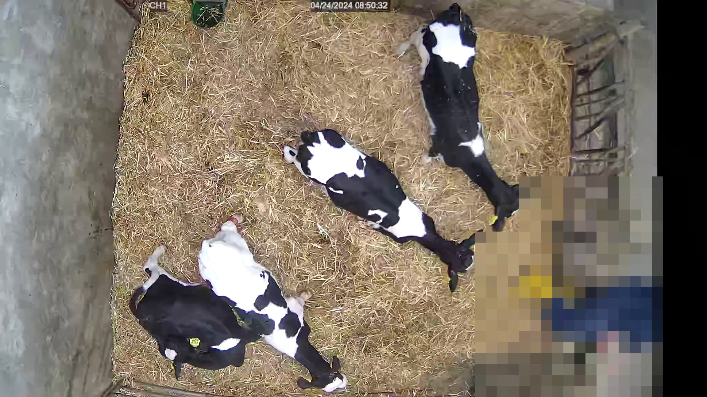
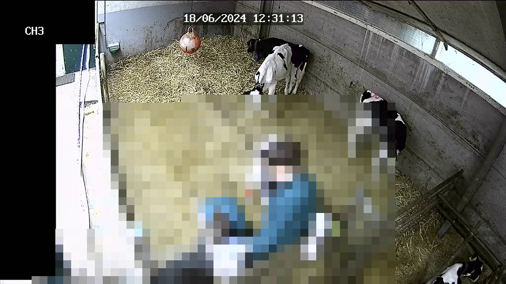
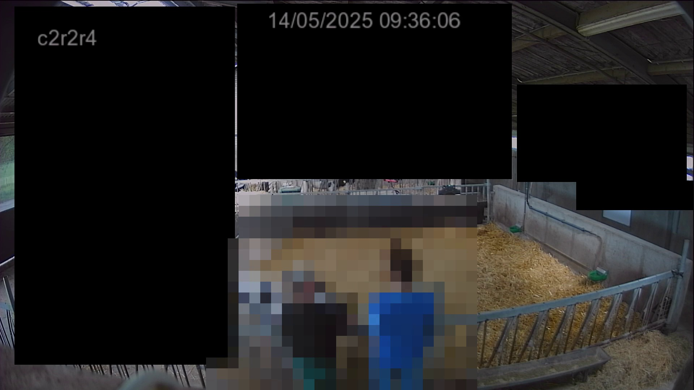
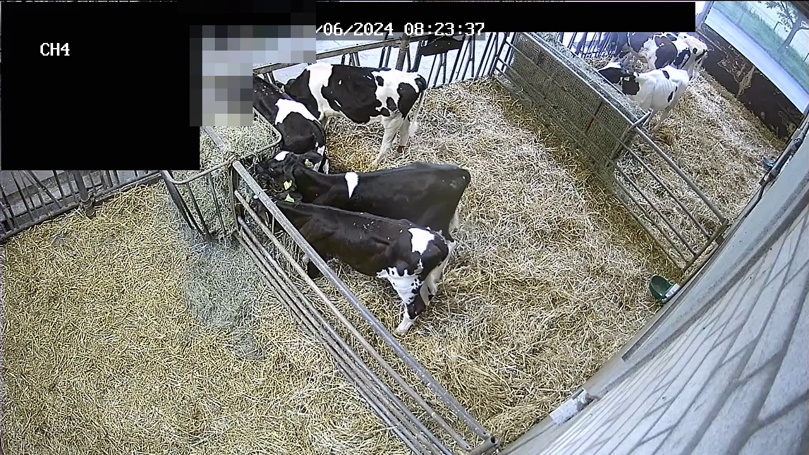
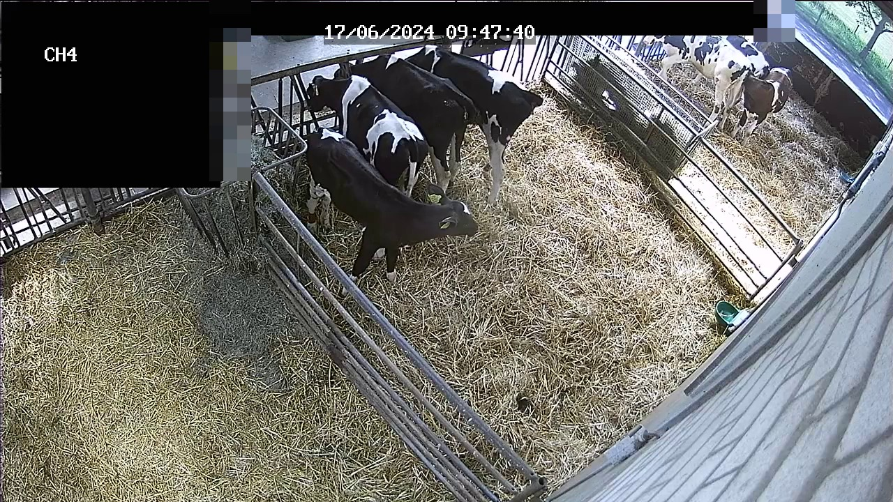
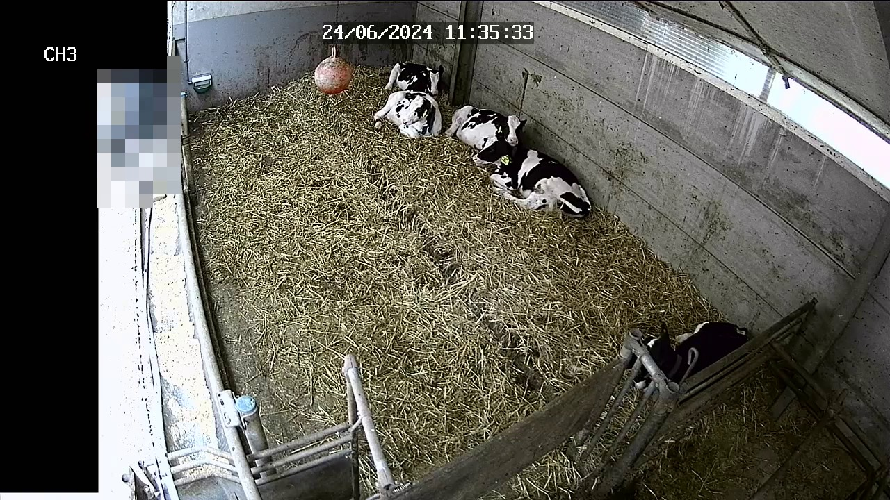

# Case study: a calf play-behaviour video dataset

OpenVeil is meant for any footage in which people appear but are not the
subject: farms, factories, laboratories, warehouses, wildlife cameras. So far
it has been tested on one case, the one described here: a research dataset of
calf play behaviour, recorded with fixed cameras in calf barns on two dairy
farms. The footage was collected to study the calves, but farm staff and
visitors enter the barns to feed, clean and check the animals, so people appear
in many videos. The dataset could only be released openly once those people
were masked. Every number on this page is for this footage; nothing here is a
result for another kind of footage.

The dataset is described in a data descriptor
([arXiv:2611.21706](https://arxiv.org/abs/2611.21706)). Version 1.2
([DOI 10.57967/hf/11689](https://doi.org/10.57967/hf/11689)) of the
[Calf Play Behavior Dataset](https://huggingface.co/datasets/Sonam5/Calf-Play-Behavior-Dataset)
is the masked release produced with OpenVeil.

Farms and recordings are given pseudonyms here: **Farm A** and **Farm B**, with
four recordings `FarmA_R1`, `FarmA_R2`, `FarmA_R3` and `FarmB_R1`.

## Results at a glance

The headline numbers of the case study: 1,173 videos (651 h, about 50.8 million
frames) from two farms. The sections below give the details.

The numbers were measured on four sets of frames
([design_rationale.md](design_rationale.md#2-how-we-measured) describes them in
full):

- **Training set**: 3,004 frames from 1,041 videos. Large language model (LLM)
  agents pre-labelled the person boxes, and one of the authors then reviewed
  every frame. The verifier was trained on these labels.
- **Validation set**: 261 frames from 76 one-minute pilot clips, with 145
  people in 119 frames and 142 frames without a person. It was enriched with
  frames in which a pre-trained YOLO detector had missed people, so it is
  harder than everyday footage. LLM agents pre-labelled it, and one of the
  authors then reviewed all 261 frames.
- **Everyday sample**: 2,000 frames drawn from 118 videos (10% of the videos of
  each recording) that were kept out of label mining: no training frame was
  taken from them.
- **Test set**: the 731 frames of the everyday sample that one of the authors
  checked in the review tool, boxing every person. It holds 172 people in 52
  frames. Rates measured on it are weighted back to the everyday sample.

| Measure | Result | Measured on |
|---|---|---|
| People covered (≥ 90% of their box under the mosaic) | **172 / 172** | test set (52 frames with people)² |
| Frames with a false mosaic box | **3.3%** [2.6–4.1] (0.45% with a big one, ≥ 15% of the image) | test set, weighted to the everyday sample² |
| Best single detector at the same share of false-box frames | 126 / 172 people (YOLO11l fine-tuned on the training set); Grounding DINO alone: 71 / 172 | test set² |
| Face detector (RetinaFace) | a face found for 66 of the 172 people; no face box covered a person | test set |
| People covered in hard frames, after hold and enlargement | **140 / 145** (loose recall¹ 0.862) | validation set, whole pipeline replayed with the released day schedule³ |
| Mosaic on hard frames without a person | 28.2% of the 142 such frames get some mosaic; it takes 1.07% of the area of all 142 | validation set, same replay³ |
| Detector calls | **0.0508 per frame** (about 5% of the frames) | whole dataset, `clock` day/night policy (sparse at night) |
| Frames carrying a mosaic in the release | **6.8%** of all video frames (7.7% of the frames of the 1,023 masked videos), 11.7% of JPEG frames | whole dataset (50.8 M video frames; all 1,106,110 JPEGs) |
| Video packets re-encoded | **12.0%**; all others copied unchanged | 1,023 masked videos |
| Masked videos passing the automatic check | **all** | 1,023 masked videos |
| Human review | 3,194 frames with a logged decision in about **2.4 h**; median **0.6 s** per frame | all review queues |

Square brackets are 95% intervals.

¹ Loose matching: a person counts as found if any kept box matches (IoU ≥ 0.5,
IoU being the overlap of two boxes from 0 to 1) a box drawn on any part of
them, so a box on a hand counts. It is lenient; see
[design_rationale.md](design_rationale.md#2-how-we-measured).
² The test set was not built independently of the pipeline. The reviewer drew
its boxes while checking the pipeline's own proposals, so a person missed by
both the pipeline and the reviewer is not counted anywhere. The verifier scores
on the test set are cross-fitted: each frame was scored by a model that had not
seen its video but had been trained on the other half of the test videos. The
threshold of 0.10 was chosen with the test-set results in view. Full coverage
therefore holds partly by construction. With no miss among 172 people, the
one-sided 95% upper bound on the miss rate is about 1.7% per person.
³ Not a held-out estimate: the released verifier was trained on other minutes
of most of the videos that the validation clips come from (no overlapping
frames).

No single detector reached this combination. With each detector set to the
threshold that covered the most people while keeping its false-box frames at or
below 3.3%, the fine-tuned YOLO11l covered 126 of the 172 test-set people,
YOLO11x 82, Grounding DINO alone 71 and OWLv2 35. Which DINOv3 verifier is used
matters much less than having one. The full comparison is in
[design_rationale.md](design_rationale.md#summary).

The outcomes by kind of case:

| Case | Outcome |
|---|---|
| Workers in everyday frames (test set) | all 172 people in the 52 frames with people are covered by the mosaic |
| Legs and boots behind a pen wall, people at the image edge | the hardest cases (see [limitations.md](limitations.md)); the validation set is enriched with them, and the whole pipeline covered 140 of its 145 people |
| Calves and objects mistaken for people | false mosaics on animals and objects: 3.3% of everyday frames keep one, 0.45% a big one (≥ 15% of the image) |
| Infrared night frames | detected with the same models; coverage in infrared could not be measured, because no reviewed infrared frame showed a person |

## The data

| | Value |
|---|---|
| Farms | 2 (Farm A, a research and teaching farm; Farm B, a commercial farm) |
| Recordings | 4 (`FarmA_R1`, `FarmA_R2`, `FarmA_R3`, `FarmB_R1`) |
| Videos | 1,173 (`FarmA_R1` 263, `FarmA_R2` 316, `FarmA_R3` 288, `FarmB_R1` 306), 651 h by their file names |
| Frames | 50,794,625 (about 50.8 million) |
| Codecs | H.264 891 files, HEVC 246, MPEG-4 Part 2 36 |
| Resolutions | 720p, 1080p and 1296p (mosaic cells of 20, 30 and 36 px) |
| Also released | 1,106,110 JPEG frames in 372 tar shards, extracted from the videos |
| Day/night | colour by day, infrared at night; no audio; date and time burned into every frame |

What makes the footage hard for a person detector:

- **Calves and cows look like crouching people** to an open-vocabulary detector,
  and a crouching person can look like a calf.
- **People are often partial**: legs and boots behind a pen wall, an arm
  reaching into a pen, a body cut off at the image edge.
- **Wide-angle cameras**: a person at the far end of a pen is small.
- **People are rare**, above all at night, and are often in view for only a few
  seconds.

## Detection

All 1,173 videos were processed with the settings of the `production` preset,
including its default prompt `worker. person. cow. calf.`, and with the `clock`
day/night policy (day 06:00–23:00) instead of the default `always_full`
(`configs/example_barn.yaml`).

| | Value |
|---|---|
| Detector (Grounding DINO) calls | 2,582,574, i.e. **0.0508 per frame** |
| Day | 2.47 M calls on 39.3 M frames |
| Night | 0.11 M calls on 11.5 M frames |
| Frames with a box (before hold and enlargement) | 4.67% overall: `FarmA_R1` 3.22%, `FarmA_R2` 3.22%, `FarmA_R3` 7.17%, `FarmB_R1` 6.31% |
| Hardware | NVIDIA A10 GPUs, several worker processes per GPU |
| GPU time (estimated) | about 122 A10-hours for Grounding DINO and about 54 for the verifier. GPU time was not metered per step; the estimate assumes 5.9 frames/s for Grounding DINO and 160 crops/s for the verifier on one A10, and as many candidates per detector call as in the dense validation clips (12.0) |
| For comparison | the day schedule at all hours (OpenVeil's default) would need about 296 A10-hours (205 + 91); Grounding DINO alone on every frame about 2,391 |
| Verifier training | 35 min on one A10 |

## Human review

One of the authors did all the review, on a local machine; the queues below
were reviewed in the review tool ([review_tool.md](review_tool.md)). The counts below are
the logged decisions: the latest decision for each frame in the review log. A
proposal box and a human box are matched greedily at IoU ≥ 0.5; "moved" means a
matched pair with IoU < 0.8; "added" counts every human box with no proposal
box at IoU ≥ 0.5, which includes boxes redrawn around a person.

| Queue | Frames | Proposal → boxes after review | Kept | Removed | Added | Moved |
|---|---|---|---|---|---|---|
| Test set (everyday frames) | 731 | 355 → 172 | 172 | 183 | 0 | 2 |
| Largest mosaics in two `FarmA_R1` pilot videos | 120 | 935 → 763 | 763 | 172 | 0 | 7 |
| Giant-rule frames (rule fires at 0.50) | 91 | 875 → 716 | 714 | 161 | 2 | 9 |
| Giant-rule frames (rule fires only at 0.40) | 139 | 1,233 → 968 | 964 | 269 | 4 | 9 |
| One recording (`FarmA_R1`) over one week, two queues | 1,007 | 2,457 → 1,626 | 1,626 | 831 | 0 | 9 |
| Random and night-clip frames of the dense validation clips⁴ | 484 | 148 → 28 | 27 | 121 | 1 | 0 |
| Training-set frames with a logged decision (checking the LLM labels, not the pipeline) | 622 | 359 → 344 | 333 | 26 | 11 | 2 |
| **All queues**⁴ | **3,194** | **6,362 → 4,617** | **4,599** | **1,763** | **18** | **38** |

⁴ One box kept in this queue was later judged by the authors not to show a
person. Without it the row has 27 boxes after review (26 kept, 122 removed) and
the totals are 4,616 boxes, 4,598 kept and 1,764 removed.

The tool logged decisions for 3,194 distinct frames (3,193 confirmed, 1 marked
unsure) in about **2.4 hours of active work**, with a median of **0.6 s per
frame**; the medians of the single queues ranged from 0.2 s to 3.5 s. Most
frames need only a glance and `Enter`. The reviewer changed 1,208 frames
(37.8%); in 808 of them every proposal box was removed. Removed boxes were
false alarms on calves and objects, or loose boxes around a group.

The training set and the validation set were both pre-labelled by LLM agents
and then reviewed in full by one of the authors. The review tool writes a log
line only when a frame is saved, so the table holds the 622 training frames
with a logged decision; the other 2,382, on which the two labelling agents had
agreed, needed no change. The review of the 261 validation frames was not made
in these queues and is not counted in the totals or in the 2.4 hours.

What the review showed:

- **No person was missing from the proposal in the test set.** All 172 people
  were already covered by it (each with ≥ 90% of their box under the mosaic at
  the released threshold), and the reviewer adjusted 2 boxes for a tighter
  fit. The reviewer checked the pipeline's proposals with the other candidates
  shown, so a person missed by both cannot appear here. All 172 people were in
  colour frames; none of the 217 infrared frames of the test set shows a
  person.
- **No missing box in the largest-mosaic queue or in the one-week check.** Of
  the 734 detection intervals of that week, 155 held a person and 579 were
  brief false mosaics. Reviews of this kind look at detections and cannot
  reveal a person who was never detected.
- **No person in the reviewed night frames.** The review of 284 frames from 12
  night clips found no person. Together with the test set, this means that
  coverage in infrared could not be measured.
- **Few boxes had to be added.** Of the 18 added boxes, 11 corrected LLM
  training labels, 6 were drawn in giant-rule frames and 1 was a second
  candidate box adopted in a daytime frame.
- **The LLM labels of the training set were mostly right.** In the 622 frames
  with a logged decision the reviewer removed 26 of 359 boxes, added 11 and
  moved 2. In a random sample of 200 frames with people, 17 of 271 boxes (6%)
  were wrong, most of them on boots next to the pen; in a random sample of 300
  frames labelled person-free, one person had been missed.
- **The giant-rule frames** set the threshold of 0.55 (see
  [design_rationale.md](design_rationale.md#6-the-giant-rule), which also
  gives the stricter safety check per threshold).

## Release

| | Masked | Unchanged |
|---|---|---|
| Videos | 1,023 files; 3,439,052 of their 44,717,570 frames (**7.7%**) carry a mosaic | 150 files with no detection (byte-identical) |
| Frame shards | 270 shards; 129,011 of 1,106,110 JPEGs (**11.7%**) | 102 shards (byte-identical) |

- **Per recording**, the share of all video frames with a mosaic ranges from
  4.6% in `FarmA_R1` to 11.1% in `FarmA_R3`.
- **Smart cut** on 990 videos; the 33 masked MPEG-4 Part 2 files were
  re-encoded in full (the other 3 had no detection).
- **12.0% of video packets** (5,374,289 of 44,717,570 in the masked files) were
  re-encoded; every other packet was copied unchanged.
- **Every masked file passed the automatic check**: same packet count and
  timestamps as the source, copied packets identical, every re-encoded stretch
  decodes to one frame per packet. No file needed the fallback full re-encode.
- **Timestamp fixes**: 230 one-tick (1/90,000 s) corrections in 218 HEVC files
  of one recording, whose cameras repeat a timestamp.
- **Giant rule** removed 15,408 of 8,756,457 boxes, in 15,402 frames of 20
  videos.
- **Size**: the videos changed from 1,781.7 GB to 1,800.5 GB in total; the
  frame shards from 575.8 GB to 572.7 GB.
- The apply step ran on CPU nodes.
- **Night chunk boundaries.** The code that masked the case study
  interpolated boxes only within a 60 s chunk, so at night 3,216 frames at
  134 chunk boundaries with a box on both sides were left outside the hold.
  Those boxes are verifier output, not confirmed people. OpenVeil makes the
  last frame of every chunk a checkpoint, which closes these gaps.

## Example frames

Three frames of the released (masked) dataset, shown with the data owner's
approval; only already-masked frames are shown, never an unmasked person (see
[img/README.md](img/README.md)):

|  |  |  |
|---|---|---|
| Farm A, a frame of the released dataset after masking | Farm A, a second frame of the released dataset after masking | Farm B, a frame of the released dataset after masking |

A drawn, synthetic illustration of the mosaic (no footage) is in
[img/mosaic_grid.png](img/mosaic_grid.png); the outcomes table is in
[Results at a glance](#results-at-a-glance) above.

More frames from the other two Farm A recordings and hard cases: small or
partly visible people that the pipeline still found and masked. In each of
these frames a human reviewer confirmed that every person is covered and added
no box.

|  |  |  |
|---|---|---|
| FarmA_R3: two people masked | FarmA_R2: one partly visible person only 40 x 29 px (0.13% of the frame) | The same frame: the outline marks the mosaic, and the inset enlarges it 3x |
|  |  | |
| FarmA_R2: a partly visible person, 29 x 58 px (0.18%); the proposer scored it only 0.25 in a separate scan, and the verifier kept it | FarmB_R1: a partly visible person, 47 x 84 px (0.43%) | |

## Lessons for other datasets

The code and the procedure carry over to other footage. The released verifier
weights are only a starting point there: they were trained on calf-barn crops
only.

1. **Run detection with the default `always_full` policy**, which uses the day
   schedule at all hours. A sparse night scan saves compute but can miss short
   appearances; choose it deliberately, if at all.
2. **Look at your footage in the review tool before tuning anything.** Review
   the queues that OpenVeil builds: the largest mosaics, the giant-rule frames
   (`openveil episodes`), a random sample and, when the candidates were stored,
   those just below the threshold. The kinds of hard cases you find (partial
   people, animals, machines, night) decide which settings matter.
3. **Set the threshold on your own reviewed frames, or train a new verifier on
   them.** In the case study the share of false-box frames depended strongly on
   the frames on which the threshold was set, and training took 35 min on one
   A10 GPU. Keep the frames you use to evaluate the verifier out of its training.
4. **Check a random sample after masking and count what you find.** That count
   is your evidence for the release.
5. **Tell users what you did.** The dataset card lists the procedure, the
   numbers above and a private way to report a missed person.
