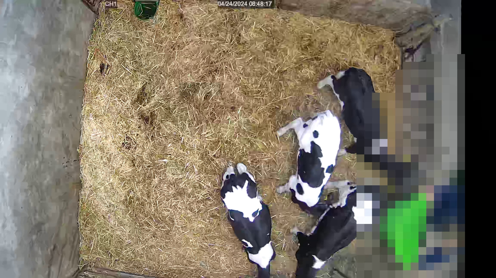
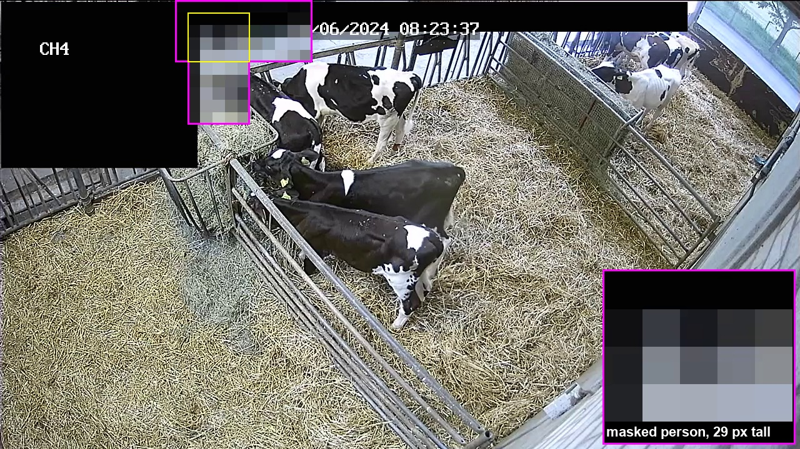

# Case study: a calf play-behaviour video dataset

OpenVeil was built for, and first used on, a research dataset of calf
play behaviour recorded with fixed cameras in calf barns. The footage was
collected to study behaviour, but barn staff and visitors walk through the pens
every day, so people appear in many videos. The dataset could only be released
openly once those people were masked.

The dataset is described in a data descriptor
([arXiv:2611.21706](https://arxiv.org/abs/2611.21706)). Version 1.2
([DOI 10.57967/hf/11689](https://doi.org/10.57967/hf/11689)) of the
[Calf Play Behavior Dataset](https://huggingface.co/datasets/Sonam5/Calf-Play-Behavior-Dataset)
is the masked release produced with OpenVeil.

Farms and recordings are given pseudonyms here: **Farm A** and **Farm B**, with
four recordings `FarmA_R1`, `FarmA_R2`, `FarmA_R3` and `FarmB_R1`.

## Results at a glance

The headline numbers of the case study, a calf play-behaviour dataset of 1,173 videos (about
50.8 million frames) from two farms. The sections below give the details.

| Measure | Result | Evaluation set |
|---|---|---|
| People covered (≥ 90% of their area under a mosaic) | **172 / 172** | 731 everyday frames checked by a human (HUM731; 52 frames with people) |
| Frames with a false mosaic box | **3.3%** (0.4% with a big one, ≥ 15% of the image) | HUM731, weighted to 2,000 sampled everyday frames |
| Recall on hard validation frames | **0.862** (loose matching¹) | 261 validation frames enriched with partial and missed people (VAL261), full pipeline with the production schedule; scored by the released model² |
| False mosaic area | **0.22%** of frame area | VAL261 schedule replay² |
| Detector calls | **0.0508 per frame** | whole dataset, `clock` day/night policy (sparse at night) |
| Frames carrying a mosaic in the release | **6.8%** of all video frames (7.7% of the frames of the 1,023 masked videos), 11.7% of JPEG frames | whole dataset (50.8 M video frames; all 1,106,110 JPEGs) |
| Video packets re-encoded | **12.0%**; all others copied bit-exact | 1,023 masked videos |
| Masked files passing the automatic check | **all** | 1,023 videos, 270 frame shards |
| Human review speed | **0.6 s** median per frame; 3,194 frames in about 2.4 h | all review queues |

¹ Loose matching: a person counts as found if any mosaic box matches (IoU ≥ 0.5,
IoU being the overlap of two boxes from 0 to 1) a box drawn on any part of
them, so a box on a hand counts. It is lenient; see
[design_rationale.md](design_rationale.md#2-how-we-measured).
² Scored by the released model, whose training data include other minutes of
most of the same source videos (no overlapping frames): not a held-out
estimate. HUM731 is scored by a model trained without its videos.

Compared with the alternatives we tried, the final cascade was the only option
that combined full coverage of people in everyday frames with a low false-mosaic
rate (see [design_rationale.md](design_rationale.md#summary)).

The outcomes in numbers:

| Case | Outcome |
|---|---|
| Workers in everyday frames (HUM731) | all 172 people in the 52 frames with people covered by the mosaic |
| Legs and boots behind a pen wall, people at the image edge | the hardest cases (see [limitations.md](limitations.md)); VAL261 is enriched with them, and 14% of its people are not found under loose matching |
| Calves and objects mistaken for people | false mosaics on animals and objects: 3.3% of everyday frames keep one, 0.4% a big one (≥ 15% of the image) |
| Infrared night frames | detected with the same models; recall with people at night was not measured |

## The data

| | Value |
|---|---|
| Farms | 2 (Farm A, Farm B) |
| Recordings | 4 (`FarmA_R1`, `FarmA_R2`, `FarmA_R3`, `FarmB_R1`) |
| Videos | 1,173 (`FarmA_R1` 263, `FarmA_R2` 316, `FarmA_R3` 288, `FarmB_R1` 306) |
| Frames | 50,794,625 (about 50.8 million) |
| Codecs | H.264 891 files, HEVC 246, MPEG-4 Part 2 36 |
| Resolutions | 720p, 1080p and 1296p (mosaic cells of 20, 30 and 36 px) |
| Also released | 1,106,110 JPEG frames in 372 tar shards, extracted from the videos |
| Day/night | colour by day, infrared at night |

What makes the footage hard for a person detector:

- **Calves and cows look like crouching people** to an open-vocabulary detector,
  and vice versa.
- **People are often partial**: legs and boots behind pen walls, an arm reaching
  into a pen, a body cut off by the image edge.
- **Infrared night footage** with low contrast.
- **Wide-angle cameras** where a person at the far end is small.

## Detection

All 1,173 videos were processed with the settings of the `production` preset,
with the `clock` day/night policy (day 06:00–23:00) and the case-study prompt
`worker. person. cow. calf.`.

| | Value |
|---|---|
| Detector (Grounding DINO) calls | 2,582,574, i.e. **0.0508 per frame** |
| Day | 2.47 M calls on 39.3 M frames |
| Night | 0.11 M calls on 11.5 M frames |
| Frames with a box (before hold and enlargement) | 4.67% overall: `FarmA_R1` 3.22%, `FarmA_R2` 3.22%, `FarmA_R3` 7.17%, `FarmB_R1` 6.31% |
| Hardware | NVIDIA A10 GPUs, several worker processes per GPU |
| Cost | about 280 A10-hours estimated by a schedule replay before the run, which assumed 0.085 detector calls per frame, 5.9 frames/s for Grounding DINO and 160 crops/s for the classifier; the real run made 0.0508 calls per frame, about 120 Grounding DINO hours at the same assumed speed. Billed hours were not recorded |

## Human review

One reviewer used the review tool ([review_tool.md](review_tool.md)) during
development and before release. Counts below come from the latest decision for
each frame in the review log. A proposal box and a human box are matched
greedily at IoU ≥ 0.5; "moved" means a matched pair with IoU < 0.8.

| Queue | Frames reviewed | Proposal → human boxes | Kept | Removed | Added | Moved |
|---|---|---|---|---|---|---|
| Everyday frames (HUM731, a sample of 2,000 held-out frames) | 731 | 355 → 172 | 172 | 183 | 0 | 2 |
| Largest mosaics in two pilot videos | 120 | 935 → 763 | 763 | 172 | 0 | 7 |
| Giant-rule frames (fires at 0.50) | 91 | 875 → 716 | 714 | 161 | 2 | 9 |
| Giant-rule frames (fires only at 0.40) | 139 | 1,233 → 968 | 964 | 269 | 4 | 9 |
| Detections of one recording over one week (two queues) | 1,007 | 2,457 → 1,626 | 1,626 | 831 | 0 | 9 |
| Night-time and random dense frames | 484 | 148 → 28 | 27 | 121 | 1 | 0 |
| Training-label frames (checking the LLM labels, not the pipeline) | 622 | 359 → 344 | 333 | 26 | 11 | 2 |

Overall the reviewer decided 3,194 distinct frames (3,193 confirmed, 1 marked
unsure) in about **2.4 hours of active work**, with a median of **0.6 s per
frame**. Most frames need only a glance and `Enter`.

What the review showed:

- **No missed person in everyday frames.** All 172 people in HUM731 were already
  covered (each with ≥ 90% of its area under a mosaic at the production
  threshold). All of them were in colour frames; none of the 217 infrared
  frames checked showed a person, so recall on infrared footage is not known.
- **Detection reviews found no missing box** in the largest-mosaic frames and in
  the one-week check (734 detection intervals, of which 579 were false alarms).
  Such reviews look at detections and cannot reveal people who were never
  detected.
- **One person at night was missed** by the 5 s night scan: an infrared figure
  in view between two checks. It was added by hand (a `manual` box, which
  OpenVeil's overrides file now generalises).
- **The giant-rule frames** set the threshold of 0.55 (see
  [design_rationale.md](design_rationale.md#6-the-giant-rule)). In the table,
  "added" counts every human box with no proposal box at IoU ≥ 0.5, which
  includes boxes redrawn around a person; the stricter safety check per
  threshold is given in the design rationale.

## Release

| | Masked | Unchanged |
|---|---|---|
| Videos | 1,023 files; 3,439,052 of their 44,717,570 frames (**7.7%**) carry a mosaic | 150 files with no detection (byte-identical) |
| Frame shards | 270 shards; 129,011 of 1,106,110 JPEGs (**11.7%**) | 102 shards (byte-identical) |

- **Smart cut** on 990 videos; the 33 masked MPEG-4 Part 2 files were
  re-encoded in full (the other 3 had no detection).
- **12.0% of video packets** (5,374,289 of 44,717,570 in the masked files) were
  re-encoded; every other packet was copied bit-exact.
- **Every masked file passed the automatic check**: same packet count and
  timestamps as the source, copied packets identical, every re-encoded stretch
  decodes to one frame per packet. No file needed the fallback full re-encode.
- **Timestamp fixes**: 230 one-tick (1/90,000 s) corrections in 218 HEVC files
  of one recording, whose cameras repeat a timestamp.
- **Giant rule** removed 15,408 of 8,756,457 boxes, in 15,402 frames of 20
  videos.
- **Size**: the videos changed from 1,781.7 GB to 1,800.5 GB in total; the
  frame shards from 575.8 GB to 572.7 GB.
- The apply step ran on CPU nodes.

## Example frames

Three frames of the released (masked) dataset, shown with the data owner's
approval; only already-masked frames are shown, never an unmasked person (see
[img/README.md](img/README.md)):

|  |  |  |
|---|---|---|
| Farm A, a frame of the released dataset after masking | Farm A, a second frame of the released dataset after masking | Farm B, a frame of the released dataset after masking |

A drawn, synthetic illustration of the mosaic (no footage) is in
[img/mosaic_grid.png](img/mosaic_grid.png); the outcomes table is in
[Results at a glance](#results-at-a-glance) above.

More frames from the other two Farm A recordings and hard cases: small or
partly visible people that the pipeline still found and masked. In each of
these frames a human reviewer confirmed that every person is covered and added
no box.

|  |  |  |
|---|---|---|
| FarmA_R3: two people masked | FarmA_R2: one partly visible person only 40 x 29 px (0.13% of the frame) | The same frame: the outline marks the mosaic, and the inset enlarges it 3x |
|  |  | |
| FarmA_R2: a partly visible person, 29 x 58 px (0.18%); detector score only 0.25, kept by the verifier | FarmB_R1: a partly visible person, 47 x 84 px (0.43%) | |

## Lessons for other datasets

1. **Look at your footage with the review tool before tuning anything.** The
   kinds of hard cases (partial people, animals, night) decide which settings
   matter.
2. **Train or at least check the verifier on your own domain.** The released
   verifier was trained only on calf-barn crops.
3. **Review the giant-rule frames** (`openveil episodes`), the largest mosaics
   and a random sample. Count what you find; that is your evidence for a data
   release.
4. **Decide the night policy deliberately.** A sparse night scan saves compute
   but can miss short appearances; the default `always_full` does not.
5. **Tell users what you did.** The dataset card lists the procedure, the
   numbers above and a private way to report a missed person.
