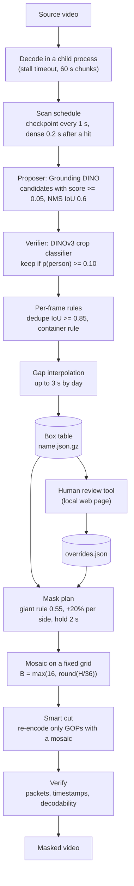

# How OpenVeil works

This page follows one video through the pipeline, stage by stage, with the
values of the `production` preset. These are the values used to mask the
case-study dataset ([case_study.md](case_study.md)). Why the pipeline looks like
this is explained in [design_rationale.md](design_rationale.md).



The pipeline has three commands that you can run on different machines:

| Step | Command | Hardware | Output |
|---|---|---|---|
| Detect | `openveil detect` | GPU recommended | one box table per video |
| Review | `openveil review build / serve / export` | any laptop | decisions, overrides |
| Apply | `openveil apply video` / `openveil apply images` | CPU | masked files |

The box table sits between detection and applying. It is small, it holds no
pixels, and every later decision (thresholds of the giant rule, enlargement,
hold, human corrections) is applied to it without running a GPU again.

---

## 1. Decoding

Video is decoded with PyAV in a **child process**. The parent kills the child
when no frame arrives for a set time (300 s before the first frame, 120 s after
that) and retries. Some camera files make the FFmpeg decoder hang without an
error; a separate process is the only reliable way to recover from that.

Frames whose presentation timestamp (pts) does not increase are dropped (up to
50 per file). Some cameras write the first two frames with the same pts.

The video is processed in **chunks of 60 s**. Each chunk is decoded, scanned and
released before the next, so memory does not grow with video length.

## 2. Day and night

Each chunk gets a mode: `full` (the day schedule) or `sparse` (the night
schedule).

- **Default policy, `always_full`:** every chunk uses the day schedule. This is
  the safe choice when you do not know when people can be present.
- **Optional policy, `clock`:** the mode follows the camera clock. In the case
  study the day was 06:00–23:00, read from the recording start time plus the
  offset in the file. A chunk counts as day when its start, or its end plus a
  300 s margin, falls in the day. In the case study the night chunks needed
  0.11 M detector calls for 11.5 M frames, against 2.47 M calls for 39.3 M day
  frames. The price is a coarser scan at night (see section 3): a person in view
  for less than about 5 s can be missed. A day window that crosses midnight
  (`day_start` > `day_end`, for example a camera clock in UTC) is allowed.

## 3. Scan schedule

Running the detector on every frame is expensive and unnecessary, because a
person in view stays in view for many frames. OpenVeil scans **sparsely and goes
dense only around detections**:

| Setting | Day (`full`) | Night (`sparse`) |
|---|---|---|
| Checkpoint interval | 1.0 s | 5.0 s |
| After a hit | back-fill from the previous clear checkpoint, then a detector call every 0.2 s | no dense mode |
| Return to sparse | after 2 checkpoint intervals (2 s) without a hit | – |
| Checkpoints per detector batch (lookahead) | 4 | 4 |
| Last frame of each chunk | always a checkpoint | always a checkpoint |

The last frame of a night chunk is a checkpoint too, so that a person who stays
in view keeps a box up to the chunk boundary and the end of the video (the ±2 s
hold alone cannot bridge a 5 s checkpoint gap across chunks). The case-study
code did not do this at night; OpenVeil does (see
[Differences from the case-study code](#15-differences-from-the-case-study-code)).

The strides are computed from the frame rate the container states (its average
frame rate), or from a rate given per video (`fps` in the job list of
`run_many`); when the container states none, the rate measured on the first
decoded chunk is used. The chunks follow the duration the container states;
afterwards the file is probed once for frames beyond it, and a file without a
stated duration is read until a probe finds no further frame (an empty chunk,
for example a recording pause, does not end the scan).

A *hit* is any frame where at least one box survives verification (section 5).
In the case study (with the `clock` policy) this schedule needed
**0.0508 detector calls per frame**, about 1 in 20 frames.

## 4. Proposer: Grounding DINO

[Grounding DINO base](https://huggingface.co/IDEA-Research/grounding-dino-base)
is an open-vocabulary detector: it finds boxes for the phrases in a text prompt.

- **Prompt.** The default is the case-study prompt
  `"worker. person. cow. calf."`: *worker* and *person* are **positive phrases**,
  *cow* and *calf* are **competitor phrases**. Naming the animals gives the
  model somewhere else to put animal-shaped boxes, and the released verifier
  was trained on the candidates of this prompt, with the animal candidates as
  negatives. For other footage, replace *cow* and *calf* with the animals or
  objects that are mistaken for people there (for example
  `"worker. person. horse."` with `competitor_phrases: [horse]`) and re-check
  the verifier on that footage ([configuration.md](configuration.md)).
- **Score.** A box's score is the maximum over the positive phrase groups.
- **Input size.** Shortest edge 800 px, longest edge at most 1333 px.
- **Speed settings.** fp16 autocast, batch 4. On a CUDA out-of-memory error the
  batch is halved and the call is retried.

## 5. Candidates and the crop verifier

Grounding DINO is used with a **low threshold** so that it misses as little as
possible. That gives many false boxes (calves, cows, posts, shadows). A second
model, the crop verifier, removes most of them.

**Candidates.** Boxes with a score ≥ 0.05 are kept. Of two candidates that
overlap with IoU ≥ 0.6 only the higher-scoring one stays (greedy NMS, best
first). This is exactly the rule used to build the verifier's training data.

**Verifier.** For each candidate:

1. The frame is resized to 1280 px wide and round-tripped through JPEG at
   quality 90. This matches how the training crops were made, so the model sees
   the same kind of input it was trained on.
2. The crop is the box plus 10% context on each side.
3. The crop is letterboxed to 224 × 224 on grey (114) and normalised with the
   ImageNet mean and standard deviation.
4. A DINOv3 ViT-L/16 backbone with a merged LoRA adapter (rank 32, alpha 64)
   produces an embedding; an MLP head (1024 → 1024 → 512 → 2) gives
   p(person).
5. The box is kept if **p(person) ≥ 0.10**. The threshold is low on purpose:
   OpenVeil prefers a false mosaic to a missed person.

The verifier weights are published separately on the Hugging Face Hub as
[`Sonam5/OpenVeil-Verifier-DINOv3-ViT-L16`](https://huggingface.co/Sonam5/OpenVeil-Verifier-DINOv3-ViT-L16)
under the DINOv3 License, not in this repository (see
[model_card.md](model_card.md)); set `verifier.adapter_dir` to the downloaded
folder. Without them you can run with verifier mode `none`: every candidate whose proposer score reaches the verifier threshold is
kept. Expect far more false mosaics on footage with animals, and raise the
threshold or review more.

## 6. Per-frame rules

After verification, two rules tidy the boxes of each detector frame:

- **Dedupe.** Of two kept boxes with IoU ≥ 0.85, one is removed.
- **Container rule.** If a kept box contains at least 2 other kept boxes (each
  ≥ 80% inside it) and is at least 3× the area of their union, it is replaced by
  that union. This shrinks loose boxes drawn around a group.

## 7. Gap interpolation

Between detector calls there are frames with no detection. When the same person
is seen on both sides of a gap, OpenVeil fills it with linearly interpolated
boxes (in pts time):

- Boxes are matched across the gap with the Hungarian algorithm on centre
  distance divided by box size, minus 2 × IoU (a greedy match is used when
  scipy is not installed).
- A pair is bridged if the gap is at most `max_gap_s` (3.0 s by day,
  max(3, 2.2 × 5.0) = 11 s at night) **and** the centres moved at most
  1.0 + 1.5 × gap box sizes, or the boxes overlap with IoU > 0.05.

Interpolated boxes are stored with kind `interp`, detector boxes with kind
`det`.

## 8. The box table

Detection writes one gzip-compressed JSON file per video, `<name>.json.gz`,
schema `openveil.boxes/1`:

```json
{
  "schema": "openveil.boxes/1",
  "video": "camera1_0800.mp4",
  "kind": "video",
  "fps": 25.0, "width": 1280, "height": 720,
  "time_base": [1, 90000], "first_pts": 0, "start_local": null,
  "params": {"...": "the settings used"},
  "chunks": [[0.0, "full", 1500, 75]],
  "frames": [[3600, [[412.0, 180.5, 498.2, 402.0, "det", 0.83]]]]
}
```

- `chunks`: start time in seconds, mode, frames in the chunk, detector calls.
- `frames`: only frames that have a box, sorted by pts. Each box is
  `[x1, y1, x2, y2, kind]` in source pixels, with an optional score. `kind` is
  `det`, `interp` or `manual`.
- Boxes are stored **before** the giant rule, enlargement and hold. Those are
  applied later, so you can change them without detecting again.
- No source path is written unless you ask for it.

## 9. Mask plan

`openveil apply` turns the table into the set of boxes to mosaic in each frame:

1. **Overrides** from the review tool are applied: boxes you added (`manual`) are
   inserted and boxes you deleted are removed.
2. **Giant rule.** A box that covers at least **55%** of the image and contains
   at least 2 smaller boxes (each ≥ 80% inside it) is dropped; the inner boxes
   stay. This removes loose boxes drawn around several people standing apart,
   which would otherwise blank most of the frame. Use `openveil episodes` to
   list where it fires so you can review those frames.
3. **Enlargement.** Each box grows by 20% of its width and height on each side,
   clipped to the image. Detector boxes are tight; the margin covers hair,
   loose clothing and small localisation errors.
4. **Hold.** A frame at time *t* gets the boxes of every table row within
   *t* ± 2.0 s. This covers frames between detector calls, people entering or
   leaving view, and short detector dropouts.

## 10. Mosaic

The image has **one grid of square cells anchored at its top-left corner**. The
cell size is

    B = max(16, round(H / 36))

which is 20 px at 720p, 30 px at 1080p and 36 px at 1296p. Every cell that
touches any box is filled with its mean value.

Because the grid is fixed to the image, not to the box, a mosaic does not
"swim" as a box moves by a pixel, and neighbouring boxes merge cleanly. Videos
are mosaicked directly on the I420 planes (Y cells of B, U and V cells of B/2),
so no colour conversion is needed.

## 11. Smart cut

Re-encoding a whole video to change 5% of its frames would degrade the other 95%
for nothing. OpenVeil re-encodes only the **groups of pictures (GOPs)** that
contain a masked frame and copies every other packet unchanged.

1. Index the packets and find the GOPs (each starts at a keyframe).
2. Mark the GOPs that hold at least one masked frame; join neighbours into runs.
3. Decode each run, apply the mosaic, and encode it again in the source codec:

   | Source codec | Encoder | Settings |
   |---|---|---|
   | H.264 | libx264 | preset medium, CRF 20, no B-frames, repeat headers, scenecut off, keyint = median source GOP |
   | HEVC | libx265 | CRF 24, the same flags |
   | anything else | full re-encode | at about the source average bit rate |

4. Mux copied and re-encoded packets in order. The source packet duration is
   copied onto re-encoded packets (otherwise the last frame can be dropped), and
   a repeated timestamp is moved by one tick.

**Eligibility.** Smart cut assumes the source is H.264 or HEVC in 8-bit 4:2:0
(`yuv420p` or `yuvj420p`, the format of the re-encoded runs), has no B-frames
and carries its parameter sets (SPS/PPS/VPS) in band. OpenVeil probes each
file; if any assumption fails it falls back to a full re-encode, and
`apply video` prints the reason. Most cameras write parameter sets in band;
files made with FFmpeg defaults often keep them only in the file header.

**Matching table and video.** The table's time base and first timestamp must
match the video (a table made before a remux into another container does not
fit), and a result in which no frame got a mosaic although the plan has boxes
fails. Masking a video in place (`--out` equal to the input) is safe.

**Verification.** `verify_fast` checks that the output has the same packet count
and timestamps as the source, that copied packets are byte-identical, and that
every re-encoded run plus the GOP after it decodes to one frame per packet. If
the check fails, the file is re-encoded in full and checked again. `openveil
verify SRC OUT` runs a full check on demand. A quality report (the PSNR outside
the mosaic and the share of mosaic pixels that changed) is available from the
Python API, `openveil.apply.quality`.

Pixels outside the mosaic but inside a re-encoded GOP change slightly (lossy
re-encoding); everything outside those GOPs is bit-exact.

## 12. Image folders and tar shards

`openveil apply images` masks still images (JPEG/PNG) in a folder or a tar file
with the boxes of a boxes JSON per image (the format is in [usage.md](usage.md#mask-still-images); the same
reader as `openveil review build --images`). Boxes are in pixels of the upright
image (after the EXIF orientation); a box outside the image is an error. With
the Python API (`openveil.apply.images.load_image_map` and `boxes_from_map`)
the boxes can instead come from the box table of the video each image was taken
from (a CSV maps each image to a video and a time). Only images that need a
mosaic are re-encoded (JPEG quality 95). In a tar, members
are rewritten one by one with their original headers, names and order;
untouched members stay byte-identical, and a check confirms this afterwards.

## 13. Running many videos

`openveil detect` takes many videos and `--workers N` to run several worker
processes on one GPU. It resumes where it stopped (finished tables are skipped),
records failures in a ledger and gives up on a video after 3 attempts, and a
watchdog restarts a worker that stops making progress. Only the video a worker
was working on when it died can be blamed: a worker that cannot build its
models is restarted and then given up without marking any video as failed, and
a missing package or verifier weights folder is reported before any worker
starts. `--retry-failed` forgets earlier failures of the listed videos.

## 14. Plugging in other models

`openveil detect --factory MODULE:FUNCTION` (or `run_many(..., factory=f)`)
replaces Grounding DINO and the crop verifier by any models. The factory is a
module-level function `f(cfg) -> (proposer, verifier)`, called once in each
worker process:

- `proposer(frames_bgr) -> [[[x1, y1, x2, y2, score], ...] per frame]`, where the
  frames are H x W x 3 uint8 BGR arrays and the boxes are in pixels;
- `verifier.threshold` (float), `verifier.mode` (str) and
  `verifier.score_frames(frames_bgr, boxes_per_frame) -> [scores per frame]`; a
  candidate is kept when its score is ≥ `threshold`.

`openveil.detect.fake:factory` is a model-free stand-in (it boxes regions much
brighter than the rest of the frame) for trying detect, review and apply on a
test clip without any download.

## 15. Differences from the case-study code

OpenVeil was built from the code that masked the case-study dataset. Box tables
written by that code are read unchanged (they keep their recorded `first_pts`
and `fps`, and a table already filtered by its giant rule is accepted). These
behaviours differ on purpose:

- **Night chunks** end with a checkpoint on their last frame (section 3).
- **Coverage**: frames past a stated duration, and frames after a recording
  pause in a file without a duration, are scanned (section 3).
- **Frame rate**: the strides come from the container's average frame rate, not
  from a separate video list; give `fps` per video to reproduce a list exactly.
- **`first_pts`** is the first frame of the video even when the first chunk is
  skipped (the old code took the first decoded chunk). The apply step always uses
  the table's own `first_pts`, so old tables stay consistent.
- **Scan modes**: an unknown mode is an error, and a detection without a hit
  flag counts as a hit.
- **Giant rule**: boxes of kind `manual` (reviewer additions) are never dropped,
  and `min_inner` must be an integer ≥ 1.
- **Prompt parsing**: a last phrase without a full stop still counts and word
  pieces are joined (`farm worker`, not `farm work ##er`); a full stop is added
  to a prompt without one. The case-study prompt parses identically.
- **Full re-encode output** has the same pixels and timestamps but different
  header bytes: the MP4 header carries the new encoder's parameter sets (the old
  code copied the source's), and the first packet repeats the encoder's
  information SEI.
- **Smart cut** is refused (full re-encode instead) for pixel formats other than
  8-bit 4:2:0, and a table whose clock does not match the video is refused.
