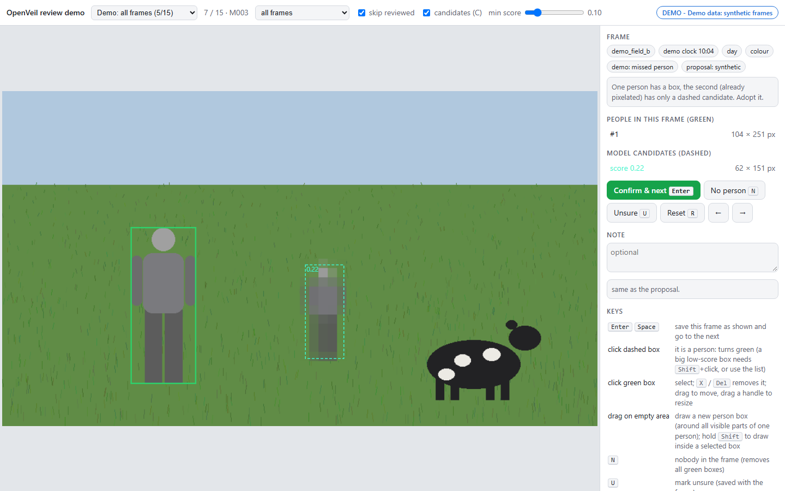
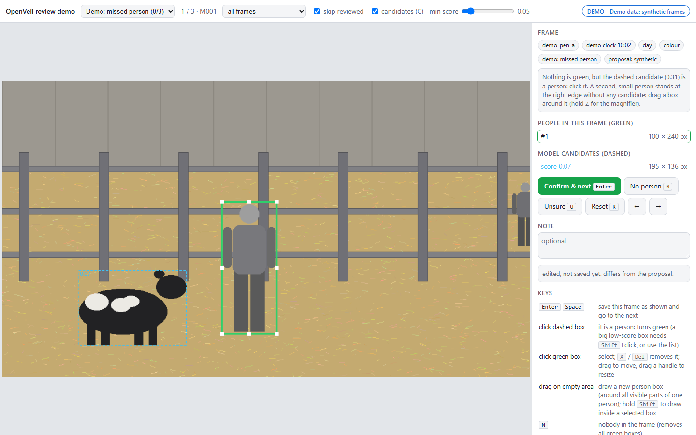
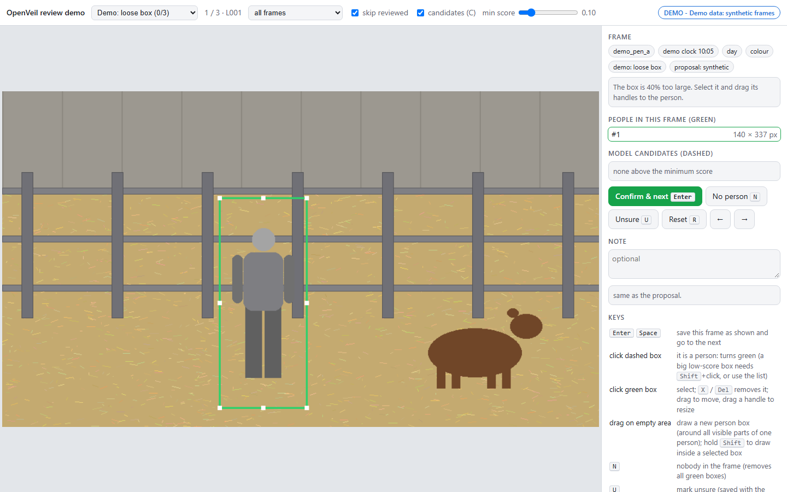
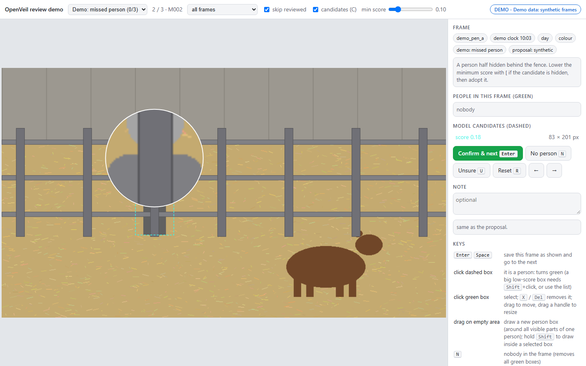
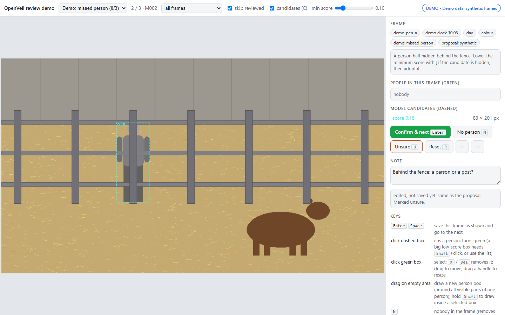

# Review tool tutorial

No detector is perfect. Before you release a dataset you need a person to look
at the frames where the pipeline is most likely to be wrong, fix them, and
count what they found. The OpenVeil review tool makes that fast: in the case
study it logged decisions for 3,194 frames in about 2.4 hours of active work by
one reviewer, with a median of 0.6 s per frame. The reviewer checks proposed
boxes and rarely has to draw one: most corrections are removals, and a box is
removed with one key.

The tool is a single local web page served by a small Python server that uses
only the standard library. It runs on your own computer; nothing is uploaded.

**See it in use (45 s, no sound).** The recording below shows the tool on its
synthetic demo: the frames are drawn, and nobody in them is real.

[](https://sonam525.github.io/OpenVeil/#review)

What happens in it, in order: a correct proposal is accepted with `Enter`; a
box on a calf is deleted with `X`; a missed person gets a box with one click on
a dashed candidate, and a second person by drawing a box; the magnifier (hold
`Z`) inspects a figure half hidden behind a fence; that frame is marked unsure
with a note; a loose box is resized by its handles. Captions above the page
name each step, and the queue selector shows the progress of each queue. Click
the recording to open the project page, which has the same recording as a
video that can be paused; the file is
[img/review_demo.mp4](img/review_demo.mp4) (1280 x 800, 1.3 MB). To click
through the same frames yourself, start the demo
([section 1](#1-try-the-demo)).

The same page as a still:



## Contents

1. [Try the demo](#1-try-the-demo)
2. [The screen](#2-the-screen)
3. [Reviewing a frame](#3-reviewing-a-frame)
4. [Editing boxes](#4-editing-boxes)
5. [Looking closely: magnifier and hide](#5-looking-closely-magnifier-and-hide)
6. [Unsure frames and notes](#6-unsure-frames-and-notes)
7. [Moving around and progress](#7-moving-around-and-progress)
8. [Review your own data](#8-review-your-own-data)
9. [Export and apply the corrections](#9-export-and-apply-the-corrections)
10. [Keyboard reference](#10-keyboard-reference)
11. [Privacy and security](#11-privacy-and-security)

## 1. Try the demo

The demo uses synthetic frames (drawn pens with grey silhouettes standing in for
people), so it contains no real person and needs no GPU or data:

```bash
openveil review demo
```

This writes a demo review folder, starts the server on port 8766 and prints the
address. Open <http://127.0.0.1:8766> in a browser. Use `--out DIR` to choose
where the demo folder goes and `--port` to choose another port.

The demo has small queues with deliberate cases: a box on an animal shape that
should be deleted, a figure the proposal missed, a box that is too loose, and
person-free frames for a random audit. Work through them while you read the
steps below.

The demo starts with a few frames already decided, so that the queue selector
shows some progress. The recording at the top of this page was made from an
empty demo; to see its first two frames in your own demo, untick **skip
reviewed** in the top bar.

## 2. The screen

**Top bar**

- **Queue selector**: the review queues, each with its progress (frames done /
  total).
- **Position**: `i / n` and the frame id.
- **Filter**: all frames, only frames where the proposal has people, or only
  frames where it has none.
- **Skip reviewed**: jump over frames that already have a decision.
- **Candidates (C)**: show or hide the model's other candidate boxes.
- **Minimum score** slider (0 to 0.9, default 0.10): candidates below this
  score are hidden.

**Canvas** (centre): the frame, scaled to fit and sharp on high-DPI screens.

- **Green solid boxes** are the current set of people. When a frame opens,
  this is the pipeline's **proposal**: the table's boxes before the giant rule,
  the 20% enlargement and the ±2 s hold of the apply step. After review they
  are what you confirm. In a giant-rule frame the note says which big box the
  rule would drop; keep it if it is a person.
- **Dashed boxes** are other candidates from the model, coloured from blue (low
  score) to red (high score), with the score printed. Candidates already covered
  by a green box (IoU > 0.6) are hidden.

**Side panel** (right)

- Chips with information about the frame (for example source, clock time,
  day/night, colour or infrared) and, once saved, *saved: status, n person(s)*.
- A short instruction for this frame, taken from its queue.
- The list of green boxes (click one to select it) and the top 12 dashed
  candidates by score (click one to adopt it).
- Buttons: **Confirm & next**, **No person**, **Unsure**, **Reset**, **←**,
  **→**.
- A note field.
- A status line: *edited, not saved yet*, *same as the proposal*, *differs from
  the proposal* or *Marked unsure*.
- A table of keys.

## 3. Reviewing a frame

The goal for every frame: **every visible person has one green box, and nothing
else has one.** A hand reaching into view or a boot at the image edge counts as
a person.

1. Look at the frame. If the green boxes are right, press **`Enter`** (or
   `Space`). The decision is saved and the next frame opens.
2. If a green box sits on something that is not a person, click it and press
   **`X`** to delete it, then `Enter`.
3. If there is nobody at all, press **`N`** (removes all boxes), then `Enter`.
4. If a person has no green box, adopt a candidate or draw a box (next
   section), then `Enter`.

A held `Enter` key is ignored on purpose, so you cannot skip through frames by
accident. Each save is written to disk immediately; stopping the server loses
nothing.

## 4. Editing boxes

**Adopt a candidate.** Click a dashed box to turn it into a green box. A large
candidate with a low score (more than 10% of the image and a score under 0.5)
needs `Shift`+click, or a click in the candidate list, so you do not adopt one
by accident. Use `[` and `]` to lower or raise the minimum score by 0.02 when
you are looking for a weak candidate, and `C` to hide the candidates.



**Select.** Click a green box. Where boxes overlap, the smallest box under the
cursor is selected. `Esc` deselects.

**Move.** Drag inside the selected box. The box stays inside the image.

**Resize.** Drag one of the 8 handles of the selected box (on boxes smaller than
24 px only the 4 corners are shown). A box shrunk below 4 px reverts.

**Draw.** Drag on an empty part of the image. The box must be at least 5 px and
at least 10 screen pixels across. To draw inside a selected box, hold `Shift`
while dragging.

**Delete.** `X`, `Del` or `Backspace` removes the selected box.

**Nobody.** `N` removes all boxes.

**Reset.** `R` restores the proposal.

**Undo.** `Ctrl+Z`, up to 100 steps.



## 5. Looking closely: magnifier and hide

- **Hold `Z`** to show a round magnifier (4×, radius 120 px) under the cursor,
  with the boxes drawn inside it. Use it for small figures, edges and infrared
  frames.
- **Hold `H`** to hide all boxes and see the raw frame.



## 6. Unsure frames and notes

If you cannot decide, press **`U`** to mark the frame unsure (press again to
undo), type a short note, then press `Enter`. Unsure frames are saved but kept
out of the exported labels, and listed separately so you can come back to them
or ask someone else.

Notes are free text (up to 500 characters) saved with the decision. Use them for
anything the next reader should know, for example "feet only, behind the wall".



## 7. Moving around and progress

- **`→`** goes to the next unreviewed frame (wrapping round at the end).
- **`←`** goes back through the frames you visited.
- Neither arrow saves. Unsaved edits are kept as drafts until you reload the
  page, and the browser warns you before you close a page with unsaved edits.
- The queue selector shows done/total per queue and updates after each save.
  With **Skip reviewed** on, opening a queue jumps to its first unreviewed frame.
- The next 2 images are preloaded, so `Enter` is instant.
- Your settings (queue, filter, skip, candidates, minimum score) are remembered
  by the browser.
- A frame can appear in several queues; its decision is shared between them.
- If the same frame is saved from two browser tabs, the second save is refused
  (the page shows *NOT saved* in red) instead of silently overwriting the first.

## 8. Review your own data

**From videos and box tables** (after `openveil detect`):

```bash
openveil review build --tables tables/ --videos videos/ --out review/ --per-queue 100
openveil review serve review/
```

`review build` extracts the frames it needs locally and writes them, with a
`manifest.json`, into `review/`. It builds these queues (up to `--per-queue`
frames each):

| Queue | What it shows | Why |
|---|---|---|
| Largest mosaics | frames where the most area would be masked | false alarms cost the most here |
| Giant-rule episodes | frames where the giant rule drops a box (see `openveil episodes`) | the rule must not uncover anyone |
| Random sample | frames drawn at random from the videos | an unbiased estimate of what was missed |
| Below-threshold candidates | frames with a candidate just under the verifier threshold (only when the tables or boxes file carry such candidates: a `candidates` list in the table or scored boxes below the threshold in a boxes JSON; `openveil detect` stores only the kept boxes, so its tables give no such queue) | the people the pipeline is most likely to miss |

**From still images** with your own boxes:

```bash
openveil review build --images frames/ --boxes boxes.json --out review/
openveil review serve review/
```

`boxes.json` maps image names (relative to the folder) to boxes in pixels of
the upright image, for example
`{"cam1/0001.jpg": [[120, 40, 210, 300], [400, 80, 460, 260, "det", 0.42]]}`.
A box is `[x1, y1, x2, y2]` with an optional kind and score (or
`{"box": [...], "score": s}`); scored boxes below `--accept` (0.10) are shown as
dashed candidates, the others as the proposal. Names are matched like
`openveil apply images` does (exactly, or uniquely ignoring letter case, a
leading `./` and leading folders); a name with boxes that matches no image is
an error. The review folder gets a `.gitignore` that keeps it out of git.

Building again into an existing folder (for example after adding videos)
keeps every frame that already has a decision: frames that no rebuilt queue
draws again move to the queue *Reviewed in an earlier build*, so their
decisions still reach the export.

Then open <http://127.0.0.1:8765> (use `--port` for another port).

**How much to review.** Review all giant-rule episodes, the largest mosaics,
and a random sample large enough to support the claim you will make in your
dataset card. Write down what you found; those numbers are part of your
evidence that the release is safe.

## 9. Export and apply the corrections

Decisions are appended to `decisions.jsonl` in the review folder (the latest
decision for a frame wins; nothing is overwritten). To turn them into results:

```bash
openveil review export review/ --overrides overrides.json
```

This writes into the review folder (the latest decision of a frame wins, then
unsure frames are filtered out):

- `human_labels.json`: the human boxes for every confirmed frame;
- `unsure_frames.json`: the unsure frames with their notes;
- `review_summary.json`, also printed on the console: per queue, frames
  reviewed, median seconds per frame, and how many proposal boxes were kept,
  removed, added or moved (greedy matching: IoU ≥ 0.5 is the same box, below
  0.8 it counts as moved or resized);
- `overrides.json` (or the path given to `--overrides`), for frames cut from
  videos: the corrections in the form `openveil apply video` understands.
  Boxes you added become `add` entries (`[t0_s, t1_s, [x1, y1, x2, y2]]`) and
  proposal boxes you removed become `delete` entries
  (`[t_s, [x1, y1, x2, y2]]`), per video, in source pixels and seconds. A box
  you moved or resized is added in its new place and the old one stays (more
  mosaic, never less). When you keep a big box the giant rule would drop, a
  `keep` entry (`[t0_s, t1_s]`) covers the whole giant-rule episode, so the rule
  drops no box anywhere in it;
- `reviewed_boxes.json`, for image-folder reviews: the human boxes of every
  confirmed image (marked `"manual"`, so the giant rule of `apply images` keeps
  them) and the proposal elsewhere, ready for `openveil apply images --boxes`.

An unsure frame never removes masking: it can only add boxes. A deleted box is
removed within the hold window around the frame where you deleted it, so it no
longer reaches that frame.

Apply them when you mask:

```bash
openveil apply video videos/cam1.mp4 --table tables/cam1.json.gz \
    --out masked/cam1.mp4 --overrides overrides.json
```

For an image-folder review:

```bash
openveil apply images frames/ --boxes review/reviewed_boxes.json --out masked_frames/
```

`human_labels.json` is also the input for evaluating or retraining the verifier
on your own domain. Keep frames you use for evaluation out of training.

## 10. Keyboard reference

| Key | Action |
|---|---|
| `Enter` / `Space` | save and go to the next frame (a held key is ignored) |
| click dashed box | adopt candidate (`Shift`+click for a big low-score one) |
| click green box | select |
| drag in selected box | move |
| drag a handle | resize |
| drag on empty area | draw a new box (`Shift` to draw inside a selected box) |
| `X` / `Del` / `Backspace` | delete the selected box |
| `N` | nobody: remove all boxes |
| `R` | reset to the proposal |
| `Ctrl+Z` | undo (up to 100 steps) |
| `Esc` | deselect |
| `U` | toggle unsure |
| `C` | candidates on/off |
| `[` / `]` | minimum candidate score −/+ 0.02 |
| hold `Z` | magnifier |
| hold `H` | hide all boxes |
| `←` | back through visited frames (does not save) |
| `→` | next unreviewed frame (does not save) |

## 11. Privacy and security

The review folder holds **unmasked frames of real people**. Treat it like the
raw footage:

- Never publish, upload or share the review folder, and keep it out of version
  control.
- The server listens on `127.0.0.1` only, so other computers cannot reach it.
- It answers only requests addressed to `127.0.0.1:<port>` or
  `localhost:<port>` (this blocks DNS-rebinding attacks), and saving requires a
  custom header that other websites cannot send.
- Images are served by frame id only; the page never sees file paths.
- Responses forbid embedding the page or its images in other sites.
- The page loads no external scripts, fonts or other resources.
- Requests are size-limited and validated (at most 100 boxes per frame, notes up
  to 500 characters, coordinates clamped to the image).
- The demo server (`openveil review demo`) refuses to start on a folder that is
  not marked as demo data.
